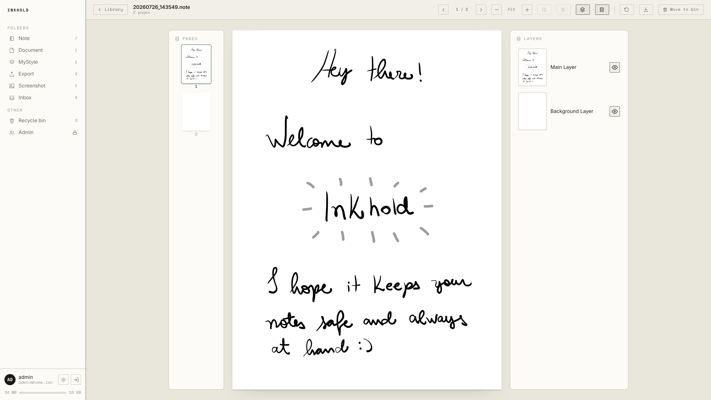
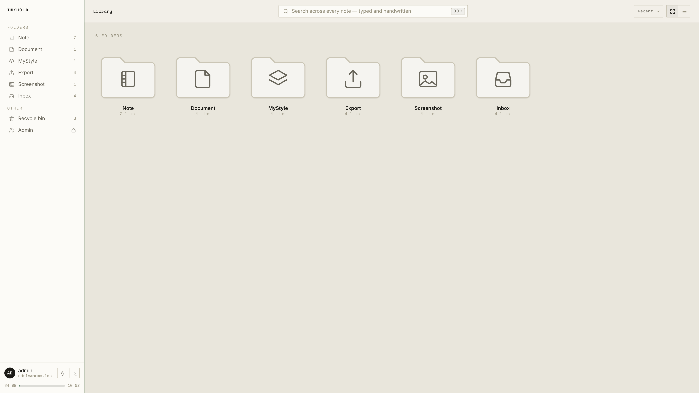
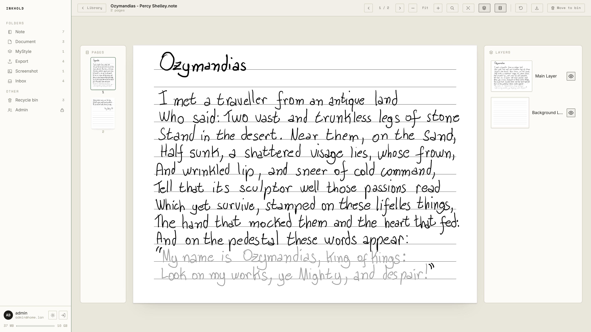
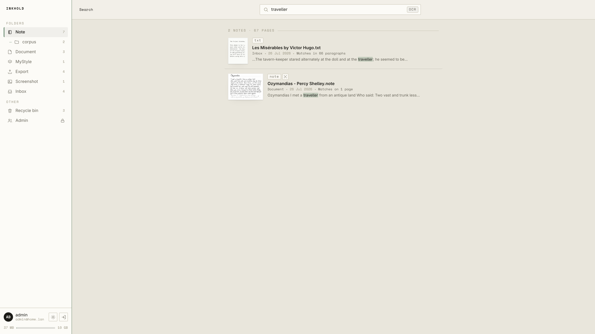

# Inkhold

**A private cloud for your Supernote — self-hosted on hardware you own, so your
notes never leave home.**

Inkhold is a drop-in replacement for Ratta's official Supernote *Private Cloud*.
Point your Supernote at it instead of the official service and your notebooks
sync exactly as before — except the server is a single small program running on
*your* machine (a home server, a spare laptop, even a Raspberry Pi), and your
handwriting is stored on *your* disk. There's also a browser app for reading,
searching, and exporting everything from any device on your network.

> **Unofficial.** Inkhold is an independent project, reverse-engineered for
> interoperability. It is **not affiliated with, endorsed by, or connected to
> Ratta or Supernote**. "Supernote" and "Nomad" are used only to describe the
> hardware Inkhold works with.



## Why run your own

- **Your notes stay home.** Nothing is uploaded to anyone else's servers. The
  sync path and the web app both live on your LAN; the internet is optional.
- **Tiny.** One binary in the low tens of MB, holding a ~50 MB memory ceiling —
  where the official stack wants ~2 GB of RAM across five processes. It runs
  comfortably on a **single-core, 32-bit Raspberry Pi from 2014**.
- **A real reading app, not just storage.** Browse your library, open notebooks
  page by page with their layers, search your *handwriting*, recover deleted
  notes, and export to PDF, PNG, or layered `.ora` — all in the browser.
- **One process, one port.** Device sync, the browser app, and (optional) TLS all
  come from the same program. No reverse proxy, no containers, no database server
  to run.

## What you can do

- **Sync your Supernote** — upload, download, capacity, folder moves/renames, and
  conflict resolution, all speaking the device's own protocol.
- **Read it in the browser** — notebooks, sketches, PDFs, images and text files,
  with per-layer viewing and in-document find. Pages render *in your browser*
  (small WebAssembly decoders), so the server only moves bytes.
- **Work through a PDF** — its own table of contents as a navigation panel, text
  you can select and copy straight off the page, fit-width zoom, go-to-page and
  Home/End, and a page index that marks which pages carry your handwriting.
- **Search your handwriting** — and your PDFs and text files, full-text across
  the whole library. Handwriting is searchable because your Supernote does the
  OCR on-device; the other formats carry their own text. The index is built and
  queried *in your browser* too, so the Pi never runs a query — and a typo still
  finds the word you meant.
- **Recover mistakes** — a recycle bin with a retention window, and per-file
  **version history** so you can look back at earlier states of a note — the
  handwriting on an annotated PDF included, which you can preview and restore.
- **Export** — any note to PDF (with a searchable text layer), a flat PNG, or a
  layered `.ora`.
- **Manage the household** — a small admin console for users, devices, quota, and
  retention.

|  |  |
|---|---|
|  |  |
| **Your library** — folders and notebooks, at a glance. | **Rich reader** — pages with their layers, in the browser. |
|  | |
| **Search your handwriting** — full-text, across every note. | |

## Beta status — please read

Inkhold is **beta software built by reverse-engineering** the Supernote protocol.
It is designed for a **single household** (a handful of devices plus browsers),
not a multi-tenant service.

- ✅ **Verified end-to-end against a real Supernote Nomad** — full upload/download
  round-trips, capacity, conflict resolution.
- ⚠️ **Keep your notes backed up.** Your Supernote keeps its own local copy, and
  Inkhold never deletes device-side data — but this is early software syncing your
  real notebooks, so don't make it the *only* place your notes live yet.
- 🔑 **Back up `cred.key`** (created on first run). It encrypts stored credentials
  and lives outside the database, so a stolen database alone yields nothing —
  and losing the key means everyone has to reset their password.

Found a bug or something surprising? **Open a GitHub issue** — that feedback is the
whole point of the beta.

## Requirements

- A machine on your home network to run it on (Linux; ARM and Raspberry Pi work).
- A Supernote **Nomad** — see [Devices](#devices).
- To build from source: the [Zig](https://ziglang.org) toolchain. To run a
  prebuilt binary: nothing.

## Get Inkhold

Three ways in. All of them end at [First run](#first-run), which is the same
either way.

### Download a binary

Rolling builds from `main`, statically linked against musl — they drop into any
Linux system without glibc version trouble.

- **[x86_64](https://nightly.link/m00qek/inkhold-beta/workflows/ci.yaml/main/inkhold-x86_64-linux-musl.zip)**
  — modern PCs and servers, cloud VMs, Intel/AMD Synology NAS (the Plus series).
- **[aarch64](https://nightly.link/m00qek/inkhold-beta/workflows/ci.yaml/main/inkhold-aarch64-linux-musl.zip)**
  — Raspberry Pi 3, 4, 400 and 5 **on a 64-bit OS**, ARM Synology NAS, ARM cloud servers.
- **[armhf](https://nightly.link/m00qek/inkhold-beta/workflows/ci.yaml/main/inkhold-arm-linux-musleabihf.zip)**
  — older Pis (1, 2, the original Zero), and newer ones still running a 32-bit OS.
- **[x86](https://nightly.link/m00qek/inkhold-beta/workflows/ci.yaml/main/inkhold-x86-linux-musl.zip)**
  — legacy 32-bit Intel/AMD machines and old thin clients.

Extract the `.zip`, and put a config beside the binary:

```sh
cp config.example.zon config.zon    # from this repository; then edit it
./inkhold                            # picks up ./config.zon from the current directory
```

To keep the config elsewhere, name it: `./inkhold --config=/etc/inkhold/config.zon`

**Set `.host` before you start.** It defaults to `127.0.0.1`, which accepts
connections only from the machine itself: your tablet and your browser will both
fail to reach it, and it looks exactly like a firewall problem. Use `0.0.0.0` to
listen on every interface, or your server's LAN address to pin it to one.

### Run the container

```sh
docker volume create inkhold
docker run -d --name inkhold -p 8089:8089 \
  -v inkhold:/var/lib/inkhold \
  ghcr.io/m00qek/inkhold-beta:latest
docker logs inkhold          # the first-run admin password is printed here
```

One tag covers **x86_64, aarch64, 32-bit ARM and 32-bit x86** — Docker pulls the
one that matches your machine. The ARM image is built for ARMv6, so it runs on
every Pi from the original B+ upward. The image is built `FROM scratch`: the server is
statically linked, so there is no base distribution in there at all, which is
why it is ~25 MB and has nothing to patch. It also means there is no shell, so
`docker exec` will not give you one.

Everything that must survive an upgrade — the database, `cred.key`, your notes
and the search index — lives in the `/var/lib/inkhold` volume. The image's
config is at `/etc/inkhold/config.zon`; mount your own over it to change the
port, turn on TLS, or set a different admin email:

```sh
docker run -d --name inkhold -p 8089:8089 \
  -v inkhold:/var/lib/inkhold \
  -v ./my-config.zon:/etc/inkhold/config.zon:ro \
  ghcr.io/m00qek/inkhold-beta:latest
```

`:latest` follows `main`. To pin a build, use the commit SHA as the tag.

### Build from source

```sh
git clone <this-repo> inkhold && cd inkhold
make serve
```

`make serve` builds the WebAssembly modules, the browser app and the server,
then **starts it**. On first use it writes the config for you, already listening
on every interface, so there is nothing to edit to get going.

It also prints the first-run admin password described below — keep that terminal
where you can read it.

The config it writes is **`server/8089/serve.zon`**, and it is written once and
never regenerated, because it names a live database. That is the file to edit.
`serve-run.zon` beside it is derived and disposable: every `make serve` rebuilds
it from `serve.zon` with only the port substituted, so changes made there are
lost on the next run.

To start it again later, either works — `make serve` rebuilds first, the binary
does not:

```sh
make serve
./zig-out/bin/inkhold --config=server/8089/serve.zon
```

## First run

Whichever way you started it, the first start does the same three things.

**It serves everything on one port** — device sync, the browser app and optional
TLS, all from the same program — **8089 by default**. Change it with `.port` in
your config, or `make serve PORT=9000`.

**It creates an `admin@home.lan` account and prints a temporary password to the
terminal.** That password is shown once. Note it down: you will be asked to
change it the first time you sign in. Sign in with the full address, not just
`admin`. To use a different one, set `.admin_email` in your config **before** the
first start — afterwards the account exists and changing it renames nothing.

**It serves the browser app at `http://<LAN-IP>:<port>`.** Open that and sign in.
`make lan-ip` prints the address; without the repository, `hostname -I` will do.

## Point your Supernote at it

On the device: **Settings → Supernote Cloud / Private Cloud → server address**,
and enter the same `http://<LAN-IP>:<port>`. Sign in with an Inkhold account, and
your notebooks sync into the library.

> Running over plain HTTP is fine on a trusted home network. For sync across the
> internet, Inkhold can terminate **TLS itself** (no reverse proxy) — see
> [TLS](#tls).

## What doesn't work yet

Honest gaps, so you know before you try:

| | |
|---|---|
| **Data Sync — To-Do and Digest** | The tablet's To-Do and Digest data does not sync. Inkhold implements the file-sync protocol; these ride a separate one that has not been reverse-engineered. Notes, folders, and the other synced types are unaffected. |
| **EPUB and Office files** | An `.epub` or a `.doc` uploads, syncs and downloads, but the browser has no viewer for it and its text is not searchable. Notebooks, PDFs, sketches, images and text files all render; notebooks, PDFs and text files are all searchable. |
| **The Supernote mobile app** | Deliberately out of scope: it expects the server to render pages, which is the one thing Inkhold pushes to the browser instead. The device syncs directly; the app does not. |

### Devices

| Device            | Status                                             |
|-------------------|----------------------------------------------------|
| Supernote **Nomad** (A6 X2) | ✅ Verified — see [Beta status](#beta-status--please-read) |
| Other Supernote models (A5 X, A6 X, **Manta** (A5 X2), …) | ❓ Untested — likely similar, help wanted |

Own a non-Nomad Supernote? Trying it and reporting back is one of the most useful
things a beta tester can do.

## Configuration

Copy [`config.example.zon`](config.example.zon) to `config.zon` and edit. Fields
are optional; omitted ones use defaults:

**`host`** — the one worth getting right: `127.0.0.1` (the default) is reachable
only from the machine itself. Use `0.0.0.0`, or your server's LAN address.

**`admin_email`** — has to be an email. Sign-in will not accept anything else, so
the server refuses to start rather than create an administrator you could not log
in as. It applies on the **first run only**.

Then `port`, `db_path`, `data_dir`, `web_dir`, `cred_key_path`,
`max_connections`, and `tls` (`enabled`, `cert_path`, `key_path`, `cipher_suites`).

## TLS

TLS 1.3 is terminated in-process (no reverse proxy needed). Set `tls.enabled =
true` with a cert and key; `bash scripts/dev-cert.sh` makes a self-signed dev
certificate to get started.

If a reverse proxy terminates TLS instead, set `trusted_proxy` to its address so
the per-IP rate limits key on the client in `X-Real-IP` (or the last
`X-Forwarded-For` hop) rather than on the proxy; have the proxy mark the session
cookie `Secure` (nginx: `proxy_cookie_flags ~ secure`), since Inkhold only does
so when it terminates TLS itself.

## For developers

[`DESIGN.md`](DESIGN.md) holds the invariants, the reverse-engineered device
protocol and the reasoning behind the architecture; the file formats are
specified in `parsers/note/note-format.md` and `parsers/spd/spd-format.md`. The
layout:

```
backend/    the Zig server — one binary, device sync + browser API + static host
webapp/     the browser app (TypeScript, zero runtime deps); wasm/ = page decoders
parsers/    the .note and .spd format parsers (own build + tests + specs)
```

Build & test:

```sh
make test-all                     # backend + frontend (unit + e2e) + parser suites
zig build test                    # backend + note unit tests
zig build -Doptimize=ReleaseSafe  # the release server binary
```

## License

Inkhold is free and open-source software, released under the **GNU General Public
License, version 3 (GPLv3)** — see [`LICENSE`](LICENSE). You can run it, study it,
change it, and share it.

## Credits

Supernote file-format understanding derives from
[supernote-tool](https://github.com/jya-dev/supernote-tool) (Apache-2.0). Inkhold
is an independent, unofficial project and is not affiliated with Ratta/Supernote.

