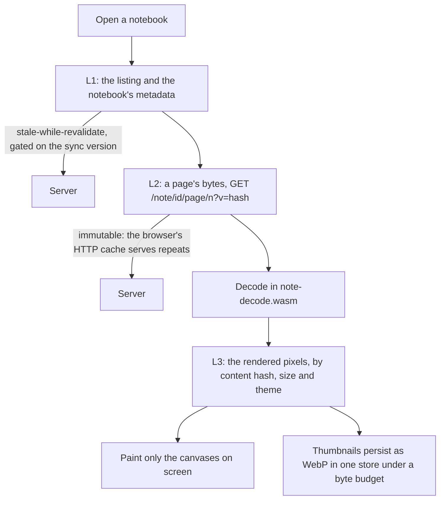

# How the browser paces its work

The browser does the work the server will not: decoding pages, rendering
PDFs, searching, exporting. Done carelessly, that would make the app slow on
exactly the devices people hold, and would still hammer the Pi with requests.
This page follows the opening of a notebook and shows how the app fetches as
little as possible, draws only what is seen, and remembers what it can. The
rules are in [The browser app](@/contributor/browser-app-rules.md).

## Four layers of remembering

**L0** is the app itself: fingerprinted files, cached as immutable, and a
service worker that keeps them. **L1** is what the person is looking at:
folder listings and a notebook's metadata. The app shows what it has at once
and revalidates in the background, and the live channel's sync version tells
it when there is anything new, so an idle tab makes no requests. **L2** is a
page's bytes. Their URL carries the page's content hash, so the response is
immutable: a page the browser has seen is never fetched again, and a changed
page is a new URL. **L3** is pixels: a rendered page is kept by its content
hash, size and theme, in memory for reader pages, and on disk as WebP for
thumbnails, in one store with one byte budget. Raw pixels were 20 to 40 times
larger.

## Drawing only what is seen

No canvas is painted until it scrolls into view, through an
`IntersectionObserver`, and a theme toggle repaints only what is visible. A
page is rendered at the size it is shown: a thumbnail tier, a fit-to-screen
tier, native resolution only for export. A text file's card reads just the
first 4 KB of the file, by a Range request, to draw its first lines; it never
fetches the whole file for a tile.

## PDFs: one document, many small reads

A PDF is too big to download before showing its first page, and its pages
share structure through the file's cross-reference table. So the app opens
the document once, in a worker running MuPDF, and reads it by Range requests
through a 32 KB block cache: the first page needs the end of the file (the
xref) and its own objects, and little else. The worker lives as long as the
viewer, so turning pages reuses what was read.

## Staying fresh without polling

The live channel is one server-sent-events stream per person. When a tablet
syncs, the stream carries the new sync version; the app revalidates its
listings and, through [search](@/contributor/search.md), fetches the new
documents' terms. Nothing polls. If the server has too many streams open, the
app gets one frame and a retry hint and tries again later.

## Where the fakes come in

Everything above is reached through four seams (the API, the renderer, the
render cache, the live channel), each with a real and a fake implementation.
Development and the end-to-end suite run on the fakes, which is why the suite
is fast and deterministic and why the fake API is the written-down reference
of how the server behaves. The cost is that a change to the server is made
twice.

## Trade-offs

### Four seams, each with a fake

**Problem.** The app must be testable without a server, and the server's behaviour must be written down somewhere executable.

**Decision.** `main.ts` wires four seams (the API, the renderer, the render cache, the live channel); each has a real and a fake implementation, and the e2e suite runs on the fakes. The fake API is the reference behaviour.

**Cost.** Every server change is made twice: in the server and in the fake.

**Revisit when** never: the fakes are what make the suite fast and deterministic.

### Hash routing

**Problem.** The server has no SPA fallback, and every place should have a URL.

**Decision.** Hash routes; navigation pushes, adjustments replace, so Back leaves a note in one step.

**Cost.** URLs carry a `#`.

**Revisit when** the server gains a fallback route.
