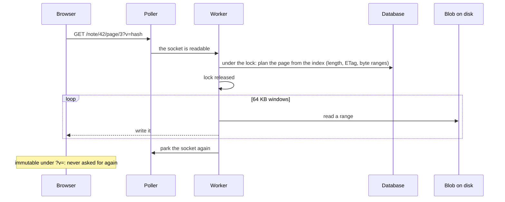

# How a request is served

The server has to answer a household's browsers and tablets on one core with
about 50 MB of memory, while a tablet uploads a 30 MB notebook and someone
searches. This page follows a request from its socket to its response and
shows where the threads, the lock and the caches sit. The rules are in
[Threads and locks](@/contributor/threads-and-locks.md) and
[Serving and caching](@/contributor/serving-rules.md).

## A socket is not a thread

A browser keeps about six connections open per tab, almost always idle. A
thread for each would spend the Pi's memory on waiting. So the server parks
every socket with one poller thread, and a small fixed pool of workers (four)
serves whatever becomes readable, then parks the socket again. A parked
socket costs about 34 KB and no thread, which makes the connection limit a
budget of file descriptors rather than of memory. The one exception is the
live channel: a stream that stays open for minutes gets a thread of its own,
with its own cap.

## One writer, many readers

SQLite has one writer. The server keeps one writer connection and holds its
lock around a whole handler, so a change to several tables is one transaction
and no handler sees another's half-done work. That lock is also the thing
that can make a slow route felt by every other one, which is why two kinds of
route step out of it.

A route flagged **read-only** runs on a pooled reader connection, without the
lock. SQLite's WAL mode lets readers run beside the writer, and with one
shared connection that was being thrown away: a 3.4 s search on the Pi used to
block everything. The flag is a promise about the whole call path, not about
the HTTP method, and an audit probes every flagged route with a write hook
armed to make sure.

A route that **streams** (a page's bytes, a file, an upload) takes the lock
only around its own database work, plans the response, and then moves the
bytes with the lock released.

The plan is the key idea: from the index alone the server knows the exact
length of the response and its ETag, and which byte ranges of the blob make it
up. Nothing is read into memory beyond one 64 KB window. A tablet's 30 MB
upload is the same shape in reverse: it streams to a temporary file while the
lock is free, and takes the lock only for the few milliseconds of recording
the result.

## The worker that waits

Anything slow that is not a response, above all [indexing](@/contributor/indexing.md),
is handed to one background worker at the lowest priority after the commit
that created the work. Signalling it inside the transaction would let it find
the work before the work existed.

## What the browser may keep

Once bytes have left, the question is whether the browser will ask for them
again. The rule is that a response may be cached as immutable only when its
cache key covers everything that can change. A page's bytes under `?v=<its
content hash>` qualify: the hash is the content, and a changed page is a new
URL. A JSON structure around those bytes does not: page text was once marked
immutable, and browsers held responses without a field for a year. Listings
revalidate against the sync version; the app's own files are fingerprinted
and immutable; `index.html` and the service worker are never cached.

The live channel ties it together. It is a server-sent-events stream per
person carrying two things: their sync version, so a listing knows when to
revalidate, and the count of files still being indexed, so search can say
what is not ready yet. Streams are admission-controlled, 16 in all and 4 per
person; one too many gets a single frame and a retry hint, never an error.

## Trade-offs

### Threads follow requests, not sockets

**Problem.** A browser keeps about six sockets per tab open; a thread per socket would spend the Pi's memory on idle connections.

**Decision.** Idle sockets are parked with one poller thread; a small fixed pool of workers serves whatever is readable. Only a held stream (the live channel) gets a thread, capped.

**Cost.** A poller and a handover add a little latency, and the pool size is a tuning number.

**Revisit when** a household's connections stop fitting in the pool's latency, which the footprint check would show.

### One writer, serialised by one lock

**Problem.** SQLite has one writer; several write connections would only contend.

**Decision.** One shared writer connection, held by `db_lock` around a whole handler. Streaming routes lock only around their own database touches.

**Cost.** The lock is not reentrant, and a long handler blocks every other write.

**Revisit when** write latency, measured by the lock histograms, grows past what a household notices.

### A pool of readers

**Problem.** With one shared connection, a 3.4 s search on the Pi blocked everything.

**Decision.** WAL readers from a pool of three, borrowed per operation, for routes flagged `read_only`; when the pool is empty, the writer serves.

**Cost.** The `read_only` flag is a claim about a whole call path and must stay true; an integration audit checks it.

**Revisit when** never on a household's scale.

### Indexing waits for a worker

**Problem.** Indexing on the upload path held the connection for up to a minute on the Pi.

**Decision.** One background worker at the lowest priority works through a job store that is a query, not a queue: each kind of job is a WHERE naming blobs that still owe work. Restart-safe and idempotent, with no claims or status column.

**Cost.** Search and thumbnails lag an upload by however long the worker takes.

**Revisit when** a household waits visibly for indexing.

### Plan, then stream

**Problem.** A page or a file must never be held whole in the server's memory on a Pi.

**Decision.** A response is planned from the index alone (exact length, ETag), then streamed from the blob in 64 KB windows with the database lock released.

**Cost.** Every byte route needs a plan, and its own lock discipline.

**Revisit when** never.

### Immutable only when the key covers everything

**Problem.** A cached response that can change under its key pins wrong data for a year.

**Decision.** `immutable` only when the cache key covers every byte that can change; JSON around opaque bytes is `no-cache`.

**Cost.** Some responses revalidate that rarely change.

**Revisit when** never. The rules themselves: [Serving and caching](@/contributor/serving-rules.md).
