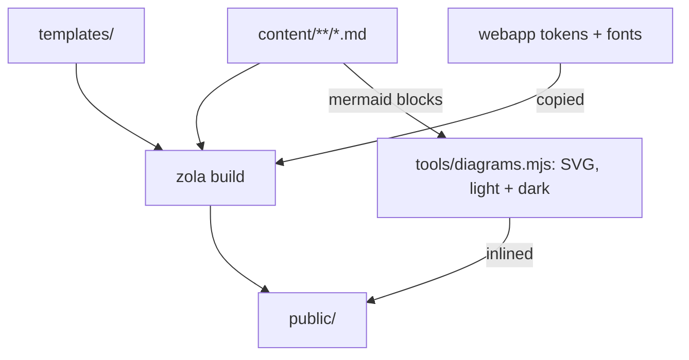

# Documentation rules

The rules every page in `docs/`, the README and the website follow. The docs
are organised by [Diátaxis](https://diataxis.fr): split first by reader, then
by what the reader needs at that moment.

## Readers and types

There are three readers:

| Reader | Who | Comes for |
|---|---|---|
| `operator` | The person who runs the server | Install, upgrade, configure, back up, restore |
| `household` | Anyone who uses it, on the tablet or in a browser | Sync, find, read, recover, To-Do |
| `contributor` | Anyone changing the code | Build, test, understand how and why it works |

`operator` and `household` share the user manual; `contributor` has its own.

Every page has exactly one reader and one type, written in its front matter
with its place in the manual:

```yaml
---
title: Restore a deleted note
weight: 2030        # its place: 1000s tutorials, 2000s how-to, 3000s reference, 4000s explanation
extra:
  reader: household
  type: how-to      # tutorial | how-to | reference | explanation
---
```

- **Tutorial**: a lesson that leads a newcomer to a first success. Few pages.
- **How-to**: the steps for one task the reader already has in mind. Most
  pages of the user manual. Steps are a numbered list; numbered headings only
  when a step has its own code and notes under it.
- **Reference**: facts to look up: settings, commands, file types, limits.
- **Explanation**: why things are the way they are.

The navigation groups each manual's pages under these four kinds. A page that
is planned but not written carries `stub: true` under `extra`, and says so on
the page and in the lists.

A page that starts to drift into another type links to that page instead.
The quadrants are not filled evenly: one tutorial is fine.

## Where files go

- Documentation lives in `docs/`, a [Zola](https://www.getzola.org) site:
  pages in `docs/content/`, the user manual under `manual/`, this manual
  under `contributor/`. `make -C docs serve` previews it as you write;
  `make -C docs build` builds it; `make -C docs check` checks it. Outside it the repository keeps only a few
  small Markdown files: `README.md` (the pitch, one picture, a short install,
  links into the docs), `LICENSE`, `SECURITY.md` and `CONTRIBUTING.md` (each a few lines
  that point into `docs/`).
- How a page becomes the site: Zola turns the Markdown into HTML with the
  templates; the app's tokens and fonts are copied in; each diagram is drawn
  to SVG beforehand and put in its page's place.



- One source for each fact. The README, the home page and the docs link to
  each other, never copy each other.

## Explanation pages carry our decisions

For contributors, explanation pages record the architectural decisions, not
only their outcome. Each decision has the same shape:

1. **Problem**: what forced a choice.
2. **Decision**: what we chose.
3. **Cost**: what we gave up.
4. **Revisit when**: what would make us choose again.

## Words

- The app's labels exactly as on screen, in bold: **Move to bin**, not
  "delete".
- The app's voice: sentence case, second person, plain verbs, present tense.
  No "simply", "just" or "easily".
- Say plainly what does not work. The limits have their own page, linked from
  the home page.
- Unofficial on every page: Inkhold is not Ratta's or Supernote's, and never
  borrows their logos or look.

## Diagrams

- Mermaid, in fenced ` ```mermaid ` blocks: GitHub renders them in the
  repository, and the website renders them to SVG at build time (no diagram
  script in the browser), in the site's colours, light and dark
  (`docs/tools/diagrams.mjs`).
- Pages are plain Markdown, never templates: Zola would otherwise run `{{`
  and `{%` in a page as code (`skip_content_templating` in `config.toml`), and
  a page must read the same on GitHub.
- Top to bottom (`flowchart TD`), not left to right: a page is a narrow
  column, and a wide diagram shrinks until its labels can't be read.
- A diagram earns its place by showing a mechanism: what talks to what, in
  which order. Every diagram has a sentence before it saying what it shows.

## Screenshots

- From the desktop web app, in the demo library (`npm run demo`), taken by a
  script (`npm run screenshots` in `webapp/`), never by hand: they never go
  stale and never show anyone's notes.
- In a page, a Markdown image whose path is `screenshots/<name>.png`, alone in
  its paragraph: the build swaps it for the light and dark files the script
  took, and the page's theme shows one.
- Where a page tells someone what to choose on a screen, show the screen.
- The home page also shows the phone version.
- Every screenshot has alt text that says what matters in it.

## Look

The website and the docs follow the app's [design language](@/contributor/design-language.md): its
type, colours, spacing and voice. The site reads the app's own tokens and
fonts (`webapp/src/styles/00-tokens.css`, `webapp/public/fonts/`), copied in
at build, never forked. They need not match the app pixel for
pixel, but they must agree with each other on every page.

## The quality bar

Every page of the site, at 320, 390, 768 and 1440 px wide, light and dark,
meets all of these. `make -C docs test` checks them
(`docs/tools/check-site.mjs`), and the docs CI runs it.

- No accessibility findings (axe: WCAG 2.2 AA and best practice), which
  includes text contrast in both themes.
- Nothing scrolls sideways. A code block, table or diagram wider than the
  column scrolls inside itself and can be reached with the keyboard.
- Every navigation target is at least 24 px, and 44 px on a phone.
- Running text is 16 px or larger, and 60 to 75 characters a line on a
  computer.
- A manual's index is a list, not a wall: one row per page, no boxes, in
  columns on a wide screen, and within three screens at 1440 × 900.
- No script errors.

## Releases

The docs describe the latest release. Anything only on `pre-release` is marked
as **Unreleased** until it ships.

## Generated, not written

Whatever can drift is generated: screenshots (from the demo), the
`config.zon` reference (from `config.example.zon`), the command-line
reference (from `--help`).

## Changes and CI

- A change to behaviour updates its docs in the same commit, like its tests.
- A docs-only change runs the docs CI (links, diagrams, the site's check and
  build), never the code CI. Docs are `docs/**` and every `*.md`; a change
  to the app's tokens or fonts runs both.
- Pages meet the quality bar above.
