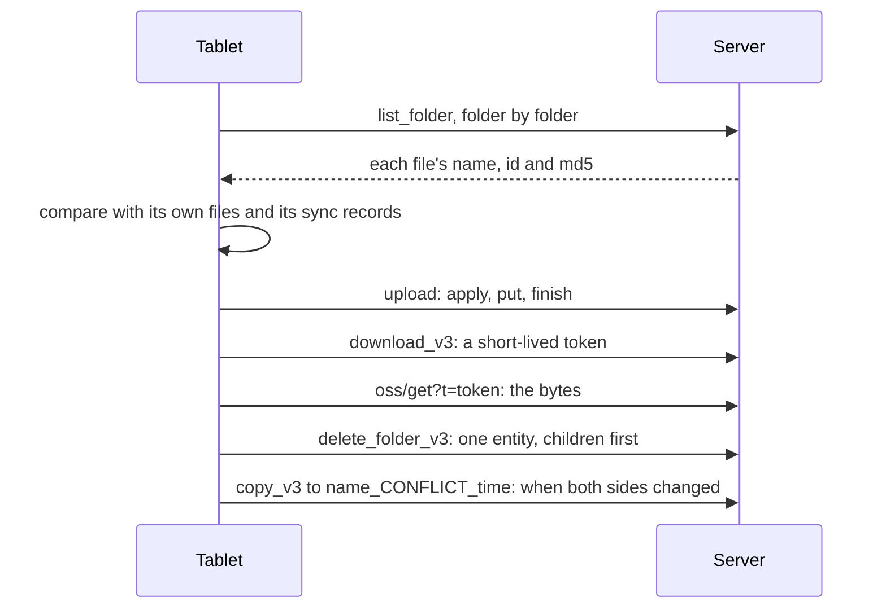

# How the tablet syncs

Inkhold speaks the protocol of Supernote's own Private Cloud, learnt by
watching a Nomad and reading its decompiled apps. The tablet is the one in
charge: it decides what to send, what to fetch and what to delete, and the
server's job is to answer in the way the tablet expects, including in the ways
that are odd. This page follows a sync from sign-in onward. The exact facts
are in [Device protocol](@/contributor/device-protocol.md).

## Signing in

The tablet asks for a random code, then sends `sha256(md5(password) + code)`.
To check that, the server must be able to compute `md5(password)` itself,
which is why passwords cannot be stored as a one-way hash
([How sign-in and trust work](@/contributor/security.md)). The answer carries a
token the tablet uses from then on. A few milliseconds later, before it has
even stored that token, the tablet sends `bindEquipment` with its serial
number; the server accepts it only because a live session for that serial
already belongs to the account.

Every failure after sign-in is an HTTP 200 with a coded body. A real 4xx or 5xx
reads to the tablet as the network failing, a 401 signs it out, and a 404 from
a delete or move aborts the whole sync.

## The walk

A sync is a walk of the tree. The tablet lists each folder, compares every
file's md5 with its own copy and with the record it keeps of the last sync,
and acts on the differences: uploads in three calls, downloads through a
short-lived token (the GET that fetches bytes carries no session), deletes one
entity at a time with the children first, and resolves a file changed on both
sides by copying one of them to a `_CONFLICT_` name beside the other, so
nothing is overwritten.

## The record the tablet keeps, and why a restore is dangerous

The tablet remembers every file it has synced: its path, its md5 and the
server's id. A remembered file that the server no longer lists reads as
"deleted in the cloud", and the tablet deletes its own copy. That is how a
delete in the browser reaches the tablet. It is also why a server that has
been reinstalled, or restored to an older snapshot, would be a disaster: every
file the server lacks would look deleted.

The tablet drops those records only at sign-in, and only when the account's id
or the library's id differs from what it stored. So Inkhold gives every library
an id, and a restore gives it a new one. At the next sign-in the tablet
forgets its records, walks the tree as if for the first time, and uploads what
the server lacks instead of deleting what it holds. Signing the tablet out is
not enough, because the records survive a sign-out; the id is what does it.

## Auto Sync

With Auto Sync on, the tablet keeps a Socket.IO websocket open. While it is
up, the tablet uploads each change as it is made, and the server pushes a
small message for each change made elsewhere (in the browser, or by another
tablet): an id, a kind of change and a path. The tablet re-reads the file by
its id and reconciles; the message carries nothing else of consequence. The
heartbeat is the server's: a `ratta_ping` every 20 seconds, which the tablet
answers.

## To-Do and Digest

The To-Do and Digest apps sync by a protocol of their own over the same
socket, and both are destructive when answered wrongly: told "no lists", the
To-Do app deletes every list it had synced; shown collections, the Digest app
imports them. So neither is ever answered with a guess. Digest is refused
outright, which stops its sync before it compares anything. To-Do is served
only when the household turns it on, and then the server stores lists and
tasks exactly as the app sends them and lets the app decide every merge. The
library id does not protect to-dos; a prompt at sign-in does, and it is why
every page about restoring says to choose **Retain locally**.

## Trade-offs

### Failures are successes with a code

**Problem.** The tablet treats any HTTP error as the network failing, and some
statuses do worse: a 401 signs it out, a 404 aborts the sync.

**Decision.** Every failure the protocol knows is an HTTP 200 with a coded
body. An unknown or foreign id answers success with the payload left out.

**Cost.** Server-side logs and tools cannot tell a refusal from a success by
status alone, and a foreign id is indistinguishable from a missing one, which
is also the point.

**Revisit when** never, while this tablet firmware is in use.

### A library has an identity

**Problem.** A tablet that resumes syncing against an older server deletes
whatever the server lacks, and signing it out does not stop that.

**Decision.** Every library carries an id; a restore or a reinstall gives it a
new one, which makes each tablet start from scratch, merging and uploading.

**Cost.** After a restore every tablet re-walks its whole library, Auto Sync
is off until turned on again, and the folders to sync may need re-ticking.

**Revisit when** the tablet offers a way to reconcile without deleting.
