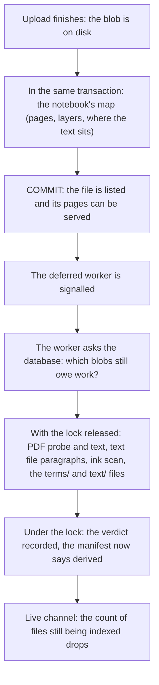

# How indexing works

"Indexing" is everything the server works out about a file beyond storing its
bytes: where a notebook's pages are inside the file, what text it carries, what
a PDF looks like, which pages have ink. None of it is needed to keep the file
safe, all of it is needed to show and search the file, and on a Raspberry Pi
some of it is slow. So the work is split: the part that is cheap and that
every later read depends on happens at upload, and the rest waits for a
background worker. The rules are in [Indexing and derived data](@/contributor/indexing-rules.md).

## What is worked out

For a **notebook** (`.note`), the index is a map of the file: for every page,
where each layer's bitmap sits (an offset and a length), the page's size and
orientation, the background template, and where the text the tablet
recognised sits, with a hash of it. With that map the server can serve a page
by streaming a few byte ranges, and the browser can decode them, without the
server ever reading the whole file into memory. The text itself is the
tablet's own handwriting recognition, read out of the file; Inkhold runs no
recognition of its own.

For a **PDF**, indexing is a probe (is it readable, how many pages, what shape
are they) and then its text, page by page, through MuPDF. For a **text file**,
it is the file split into paragraphs, each addressed by its byte range. For a
**sketch** (`.spd`), it is one parse of its SQLite database for the layers and
the thumbnail it carries. And for any notebook, a scan of its layers decides
which pages have ink at all, which search's coverage line and the PDF viewer's
page marks use.

Out of the text, whatever its source, the server derives two files per
document for search: `terms/`, the words of each page folded for matching, and
`text/`, the readable text of each page for excerpts and find-in-document.

## When it happens

The notebook's map is built inside the upload's own transaction. Parsing it is
pure CPU over a few addressed ranges (a 40 MB notebook allocates kilobytes),
and the row is written with the file's row, so a listed file is always a
servable file. Everything slower waits.

Indexing on the upload path once held the tablet's connection for the whole
derivation: 48 to 60 seconds for a 16 MB text file on the Pi, long enough for
the tablet to give up. So after the commit the server signals one background
worker, running at the lowest priority, which does the rest.

## Why the worker is a query, not a queue

The worker has no queue, no claims and no status column. Each kind of work (a
"tenant") is a database query that names the blobs still owing that work: a
PDF with no probe verdict, a notebook with no terms file at the current
version, a layer not yet scanned. The worker runs each query, does the work
with the lock released, and records the verdict under the lock.

That shape gives three things for free. **Restart safety:** after a crash the
same queries find the same unfinished work. **Idempotence:** every write is an
upsert, so doing a job twice is harmless. **Live priority:** whatever the
queries return first is done first, with no queue to reorder. A job that can
never succeed (a broken PDF, a file with no text, one over the size cap)
records that as its verdict, or it would be retried for ever. And the derived
file is always written before the verdict, never after: a crash in between
leaves work to redo, never a blob marked done with nothing behind it.

## Why it is keyed by content, and heals itself

Every index row and derived file is keyed by the blob's md5 and an
`index_version`. The same notebook uploaded twice, or restored from a backup,
shares one index. A row that is missing, or at an old version, is simply made
again on the next read or by the worker; there are no migrations that backfill
derived data. Changing what a derived file contains means bumping the version,
and that re-derives every document, which is the one real cost of the scheme.

## What the browser sees meanwhile

Between the commit and the verdict, the file is listed and readable but not
yet searchable. The browser is told, not left to guess: the search manifest
marks the document as pending rather than empty, the live channel carries the
count of files still being indexed, and a find in that document says "still
being indexed" and asks again, instead of "No matches".

## Trade-offs

### Derived data is keyed by content

**Problem.** A file can be uploaded twice, restored or renamed; derived data must never go stale or need a migration to catch up.

**Decision.** Index rows and derived files are keyed by blob md5 and an `index_version`; a missing row or an old version is re-derived on read or by the worker.

**Cost.** Changing what a derived file holds means bumping `index_version`, which re-derives every document.

**Revisit when** never: it is what lets the server stay migration-free for derived data.

### Text comes from the device

**Problem.** Running handwriting recognition costs far more than a Pi can spare.

**Decision.** A notebook's text is the tablet's own recognition (`RECOGNTEXT`); PDFs and text files give their own text. There is no OCR.

**Cost.** Handwriting the tablet never recognised, and ink on PDFs, can't be searched.

**Revisit when** the server runs on hardware that can afford recognition and people ask for it. The rules themselves: [Indexing and derived data](@/contributor/indexing-rules.md).
