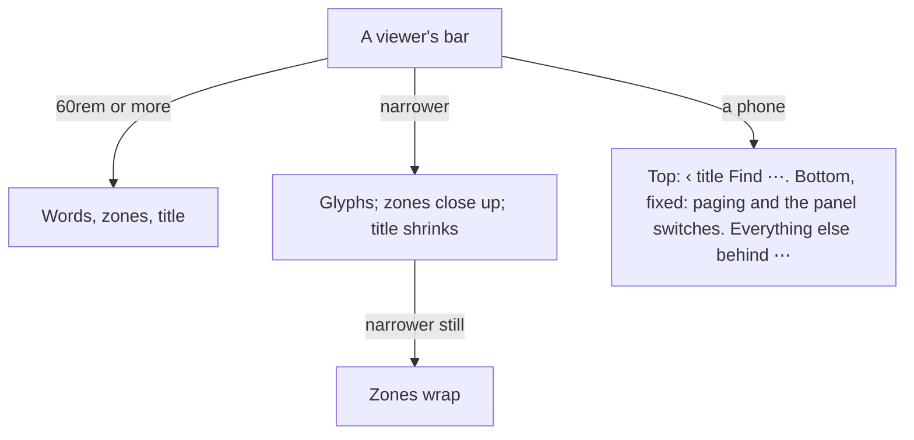
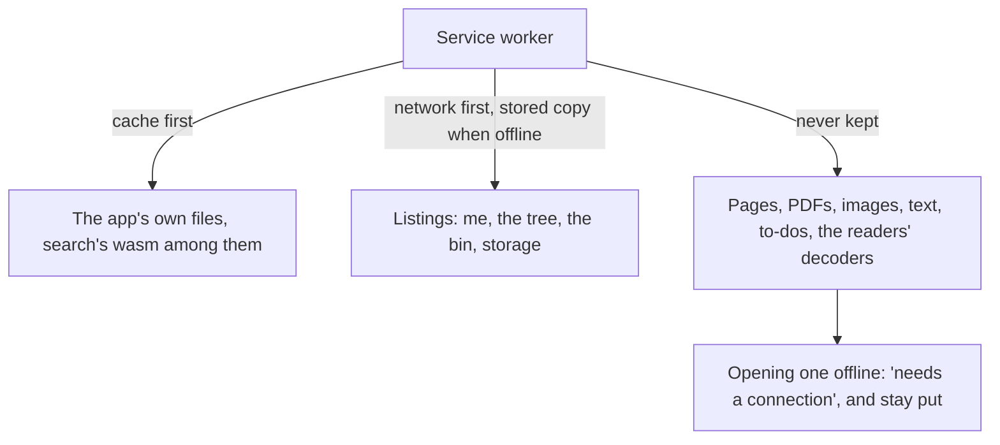

# How the app fits a phone, and works offline

The same app serves a desktop browser, an iPhone and a tablet, and installs on
a phone's home screen. This page explains the two ideas behind that: layout
decided by the room a component has rather than by the device it is on, and
an offline mode that keeps the map but not the territory. The rules are in
[Phones and offline](@/contributor/phones-rules.md).

## Layout follows the room, not the device

A width breakpoint knows the window's width, which is the wrong question
inside a narrow side panel or a split screen. So content sizes itself first
(grids that fill, rows that wrap, sizes in rem), a component asks its own
container how much room it has, and media queries only switch the page's
shape: a phone below 700px, a tablet to 1099px, a desktop from 1100px. Touch
is a separate question, asked with `pointer: coarse`, never inferred from
width: a tablet in landscape has a desktop's room and a finger's targets.

A viewer's bar is the clearest case. It is a container: under 60rem of bar
its buttons drop their words, then its zones wrap, the title giving way first.
On a phone it stops being a container so that its bottom row can be pinned to
the screen, where a thumb is, and whatever no longer fits folds into one ⋯
menu, in the bar's own order, with a long submenu (the Download menu) opening
in place under a back row rather than burying the rest.

Panels on a phone are one sheet on the bottom row rather than a column beside
the page, zoom is a pinch with the stepper kept in ⋯ as the one-finger way, a
swipe turns the page, and the page sits above the bar and any open sheet
because Fit measures the padded stage. Text size follows the system's, with
every field floored at 16px so iOS never zooms the page on focus.

## Offline: the map, not the territory

The app installs as a PWA with a service worker. What it keeps is the app's
own files and the listings a person browses with: the folder tree, the bin,
the storage meter. That is names and counts, never a file. Without a network
the app opens, shows the library as last seen, and says "needs a connection"
when a notebook is opened, instead of a viewer that never fills. Search keeps
what it answers from in the browser's own storage, apart from these: the
documents' words and text, and the last to-dos and digests, so it answers
offline too; the To-Do and Digest pages still need the server. Signing out,
or the server refusing the session, forgets the listings and everything else
the browser keeps of that person's library.

Keeping files would mean copies of people's notebooks on devices the household
cannot see or wipe, and that was judged the wrong trade for a private cloud.
An update installs beside the running version and waits for the person to
choose Reload, so a half-updated app is never shown.

## Trade-offs

### Intrinsic first

**Problem.** Width breakpoints alone break inside a narrow panel or a split screen.

**Decision.** Content sizes itself; a component asks its container how much room it has; media queries only switch the page's shape. Touch is its own question, `(pointer: coarse)`.

**Cost.** Layouts are harder to predict than fixed breakpoints, so the e2e guard visits phones and tablets.

**Revisit when** never.

### Offline means navigating, not reading

**Problem.** Keeping files on a device copies people's notes somewhere the household can't see.

**Decision.** The service worker keeps the app and the listings a person browses with, never a file: pages, PDFs, images and to-dos always come from the server.

**Cost.** Without a connection, nothing opens.

**Revisit when** people ask to read offline and accept copies on their devices.

Intrinsic first: content sizes itself (grids that fill, rows that wrap, The rules themselves: [Phones and offline](@/contributor/phones-rules.md).
rem sizes), a component asks its container how much room it has, and media
queries only switch the page's shape. That shape follows the room there is
(`00-tokens.css`): phone below 700px, tablet to 1099px, desktop from 1100px.
Touch is its own question, `(pointer: coarse)`, never inferred from width.
