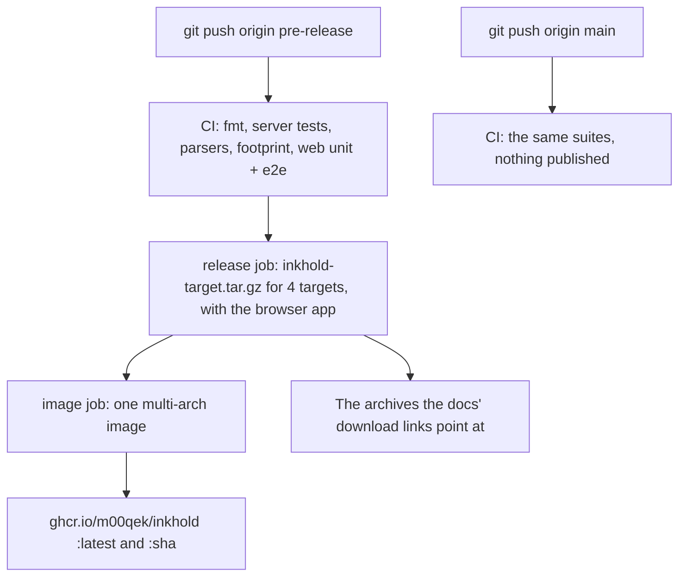

# Make a release

`pre-release` is the source of truth: every push to it is tested and, when the
suites pass, published.

What a push sets off:

1. [Cross-build](@/contributor/cross-build.md) if the server changed, and
   [run the tests](@/contributor/run-the-tests.md).
2. Push `pre-release`. CI then:
   - runs the server, parser and browser app suites, and the footprint check;
   - only if all of them pass, builds the server for the four targets, with the browser app, as
     archives (the download links in the docs point at them);
   - builds and publishes the container image for all four architectures, as
     `ghcr.io/m00qek/inkhold:latest` and as the commit's hash.
3. Check the run: the image job prints what it published.

`main` is tested on push but publishes nothing.

There are no version numbers yet: the commit is the version, and to stay on one
build people use its hash as the image tag.
