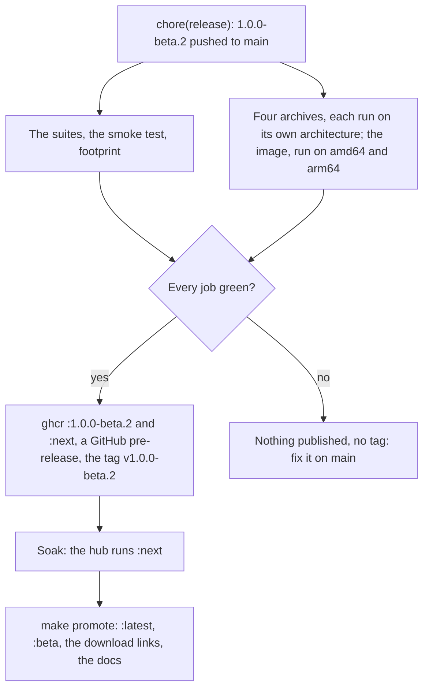

# Make a release

A release is a commit on `main` that names a new version in `build.zig.zon`.
CI builds it, runs it on every architecture and, only if every job is green,
publishes it to `:next` and tags the commit. After a soak, you promote it.



During the beta, every version is `1.0.0-beta.N`, one more than the last.

1. [Cross-build](@/contributor/cross-build.md) if the server changed, and
   [run the tests](@/contributor/run-the-tests.md). To try the release jobs
   themselves without releasing, run Actions → Test → Run workflow with
   **Rehearse** ticked: it builds and smoke-tests everything, publishes
   nothing.
2. Set `.version` in `build.zig.zon` to the next `1.0.0-beta.N`, which
   `inkhold --version` reports. `make release-status` says whether it is
   released yet, and refuses a version that could never be.
3. Commit it as `chore(release): 1.0.0-beta.N` and push `main`.
4. CI, in the same run:
   - runs the suites, the smoke test and the footprint check;
   - builds the four archives and runs each on its own architecture:
     aarch64 on an ARM runner, the Pi 1's ARMv6 emulated, x86 and x86_64
     natively;
   - builds the image and runs it on amd64 and arm64;
   - if every job is green, pushes the image as `:1.0.0-beta.N` and `:next`
     with provenance, creates the release with the archives, `SHA256SUMS`,
     provenance and the version's section of `CHANGELOG.md`, and publishes
     it as a pre-release, which tags the commit `v1.0.0-beta.N`.
5. Soak it: run `:next` on the hub and use it.
6. Promote it:

   ```sh
   make promote VERSION=1.0.0-beta.N
   ```

   `:latest` and `:beta` then point at the same image, the release becomes
   the latest one, which the docs' download links follow, and the docs site's
   root is rebuilt from its tag. Nothing else is rebuilt.

If a job fails, nothing is published and nothing is tagged. Fix it on `main`:
the version is still unreleased, so the next run tries again. After a
docs-only fix, which runs no tests, start it from Actions → Test → Run
workflow. A candidate that doesn't survive the soak is never promoted; release
the next version instead.
