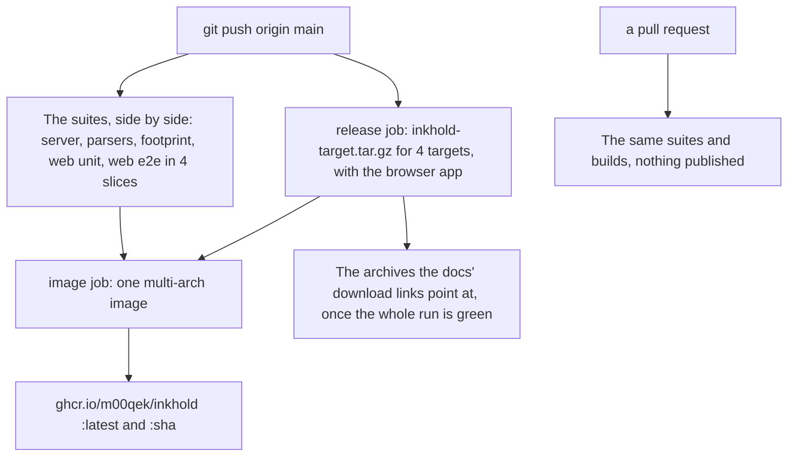

# Make a release

`main` is the only branch: every push to it is tested and, when the suites
pass, published.

What a push sets off:

1. [Cross-build](@/contributor/cross-build.md) if the server changed, and
   [run the tests](@/contributor/run-the-tests.md).
2. Push `main`. CI then:
   - runs the server, parser and browser app suites and the footprint check,
     each on its own runner;
   - meanwhile builds the server for the four targets, with the browser app,
     as archives. The download links in the docs serve the latest run that
     passed, so a failing run's archives are never downloaded;
   - once every suite has passed, builds and publishes the container image
     for all four architectures, as `ghcr.io/m00qek/inkhold:latest` and as
     the commit's hash.
3. Check the run: the image job prints what it published.

A pull request runs the same suites and builds the image, but publishes nothing.

There are no version numbers yet: the commit is the version, and to stay on one
build people use its hash as the image tag.
