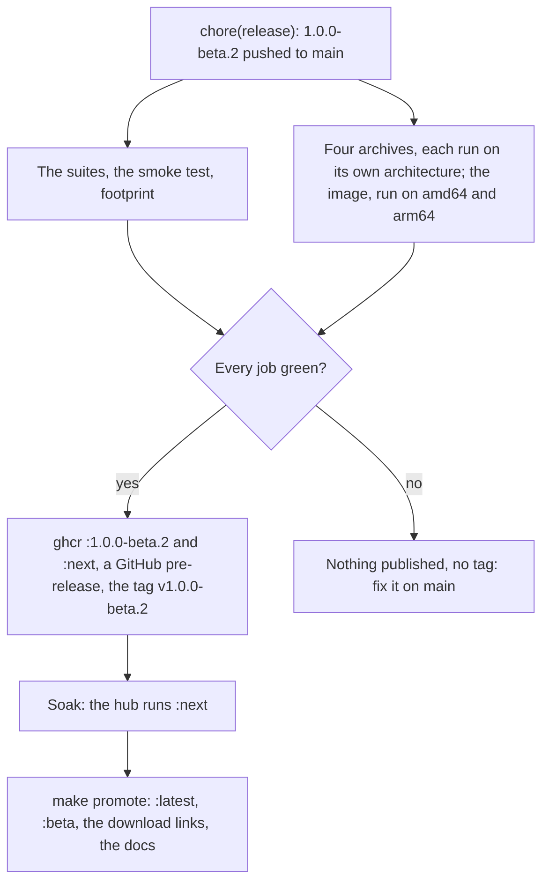

# Make a release

A release is a commit that names a new version in `build.zig.zon`. CI builds
it, runs it on every architecture and, only if every job is green, publishes it
and tags the commit. After a soak, you promote it.

Two branches:

- `main`, where work happens. It releases the next beta, `1.0.0-beta.N`.
- `stable`, what people have: the promoted release, plus fixes copied onto it
  since. It releases fixes, `1.0.0-beta.N.M`, and the docs site's root is
  built from it. Promoting a release resets `stable` to it.



During the beta, every version is `1.0.0-beta.N`, one more than the last.

1. [Cross-build](@/contributor/cross-build.md) if the server changed, and
   [run the tests](@/contributor/run-the-tests.md). To try the release jobs
   themselves without releasing, run Actions → Test → Run workflow with
   **Rehearse** ticked: it builds and smoke-tests everything, publishes
   nothing.
2. Prepare the release:

   ```sh
   make release VERSION=1.0.0-beta.N
   ```

   It refuses a version that could never be released, sets `.version` in
   `build.zig.zon` (what `inkhold --version` reports), adds the version's
   section to `CHANGELOG.md`, and prints the commits since the last release,
   by type.
3. Write that section for the people who run Inkhold, not for contributors:
   what's new and fixed, and **Upgrade notes** first when there is something
   to do before upgrading. It becomes the release's notes, and CI refuses a
   release without it.
4. Commit it as `chore(release): 1.0.0-beta.N` and push `main`.
5. CI, in the same run:
   - runs the suites, the smoke test and the footprint check;
   - builds the four archives and runs each on its own architecture:
     aarch64 on an ARM runner, the Pi 1's ARMv6 emulated, x86 and x86_64
     natively;
   - builds the image and runs it on amd64 and arm64;
   - if every job is green, pushes the image as `:1.0.0-beta.N` and `:next`
     with provenance, creates the release with the archives, `SHA256SUMS`,
     provenance and the version's section of `CHANGELOG.md`, and publishes
     it as a pre-release, which tags the commit `v1.0.0-beta.N`.
6. Soak it: run `:next` on the hub and use it.
7. Promote it:

   ```sh
   make promote VERSION=1.0.0-beta.N
   ```

   `:latest` and `:beta` then point at the same image, the release becomes
   the latest one, which the docs' download links follow, `stable` is reset
   to it, and the docs site's root is rebuilt from `stable`. Nothing else is
   rebuilt.

If a job fails, nothing is published and nothing is tagged. Fix it on `main`:
the version is still unreleased, so the next run tries again. After a
docs-only fix, which runs no tests, start it from Actions → Test → Run
workflow. A candidate that doesn't survive the soak is never promoted; release
the next version instead.

## Fix a typo in the docs

Fix it on `main`, then copy the commit onto `stable`:

```sh
make backport COMMIT=<sha>
```

`/next/` has the fix as soon as `main`'s docs run deploys; the site's root, a
few minutes after the backport. No release is needed.

## Release a fix on its own

To ship a bug fix without what `main` has gained since the last release:

1. Fix it on `main`, then `make backport COMMIT=<sha>`. The push to `stable`
   runs the full suites there, so the fix is tested beside the older code it
   now sits with: wait for that run to pass.
2. In a checkout of `stable`, `make release VERSION=1.0.0-beta.2.1`, the
   next fix of the current release (here, after `1.0.0-beta.2`). Write its
   `CHANGELOG.md` section, commit it as `chore(release): 1.0.0-beta.2.1` and
   push `stable`.
3. CI releases it as above, except that it moves only its own version tag,
   never `:next`, which stays `main`'s candidate.
4. Soak it (`:1.0.0-beta.2.1`), then `make promote VERSION=1.0.0-beta.2.1`.

`1.0.0-beta.2.1` sorts after `1.0.0-beta.2` and before `1.0.0-beta.3`. A
backport that doesn't apply cleanly stops with nothing pushed: resolve it in a
checkout of `stable` by hand.
