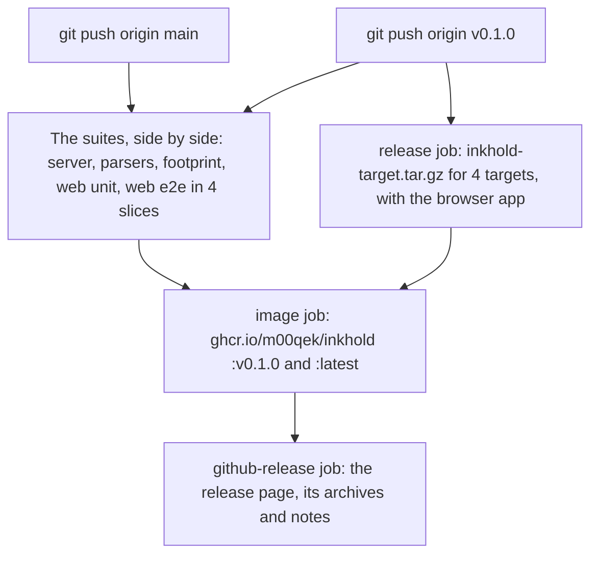

# Make a release

A push to `main` runs the suites and publishes nothing. A version tag
publishes a release: the container image and a GitHub release with the
archives.



1. [Cross-build](@/contributor/cross-build.md) if the server changed, and
   [run the tests](@/contributor/run-the-tests.md).
2. Set the version in `build.zig.zon`, which `inkhold --version` reports, and
   take **Unreleased** off what ships in it
   ([Documentation rules](@/contributor/documentation-rules.md)). Commit and
   push `main`.
3. Tag that commit with the same version and push the tag:

   ```sh
   git tag v0.1.0
   git push origin v0.1.0
   ```

4. CI then:
   - refuses the tag if it doesn't match `build.zig.zon`;
   - runs the suites, each on its own runner, and meanwhile builds the server
     for the four targets, with the browser app, as archives;
   - once every suite has passed, publishes the container image for all four
     architectures, as `ghcr.io/m00qek/inkhold:v0.1.0` and `:latest`;
   - creates the release on GitHub with the four archives and notes from the
     commits since the last tag. The docs' download links point at the
     latest release's archives.
5. Check the release page, and edit its notes if they need it.

If a suite fails, nothing is published. Fix it on `main`, then delete the tag
(`git push origin :v0.1.0`) and tag again, or tag the next version.
