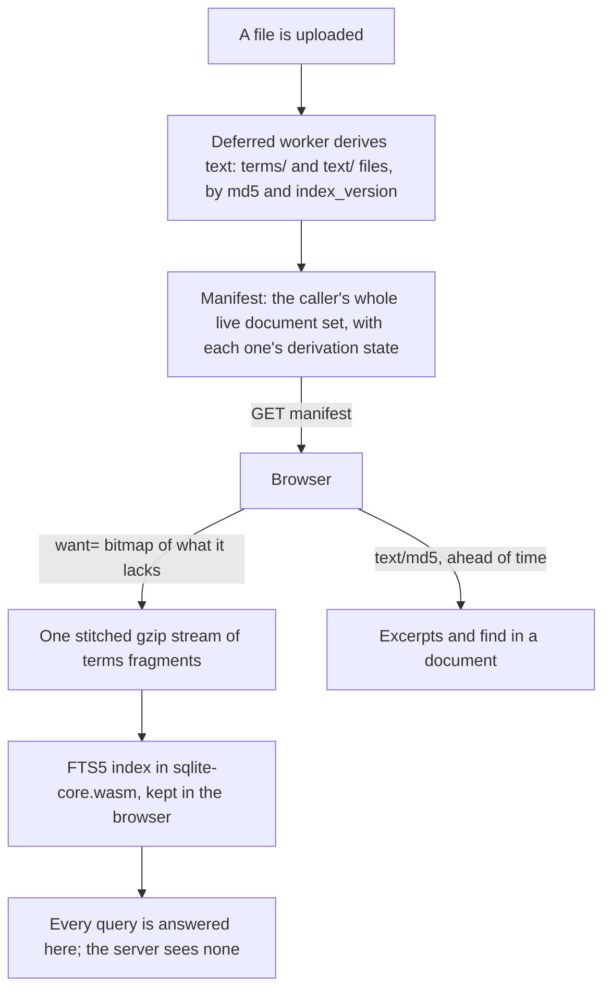

# Search

The rules of search: the index and its manifest, how words and names match,
ranking, coverage, find in a document, phrases and excerpts. Why they are this
way: [Search, end to end](@/contributor/search.md).

## The index and its manifest

Where the text comes from and where the searching happens:

- **There is no server search.** The browser downloads each document's derived
  text and answers every query from a local FTS5 index in `sqlite-core.wasm`.
  The server-side index was removed: it held `db_lock` for 98 s per
  whole-library ingest on the Pi.
- **One tokenizer.** The server and the browser share `schema.fts_tokenizer`,
  which is `unicode61 remove_diacritics 2`, and the query text goes to the wasm
  as typed. Any folding or escaping in JavaScript would be a second tokenizer,
  and the two would disagree.
- **The manifest has no tombstones.** It is the caller's complete set of live
  documents, in the binary `SMAN` format (md5, tier, derivation state, id,
  time, version), and it replaces the browser's set wholesale: a document's
  absence is the only form of deletion. So any LIMIT or extra filter on it is a
  correctness bug, and a truncated manifest can be detected, because the
  fixed-width row count comes first. Its ETag is the md5 of the body.
- **Derivation state** tells "derived, and empty" apart from "not derived yet".
  Caching the second as emptiness would make a document unsearchable for ever.
- **Fetching text.** The browser sends a `want=` bitmap over the manifest's
  positions (least significant bit first, canonical base64url) and receives one
  stitched gzip stream. It must be a single gzip member: Chromium and curl
  decode only the first member of a concatenated stream and report success.
  Node decodes them all, so a Node test can pass where a browser fails. Missing
  fragments are skipped, so the stream is chunked and `no-store`.
- Golden vectors (`manifest_golden.bin`, `want_golden.txt`) are checked by both
  the Zig encoder and the TypeScript decoder. Never regenerate one to make a
  side pass.

## Matching

- **One index for everything search finds.** Besides the documents' pages, the
  browser writes rows of its own into the same FTS5 table: file and folder
  names (`nameRows`), to-dos (`todoRows`) and digests (`digestRows`). A
  rowid's top bits are its kind (`search/itemRows.ts`, `kind_shift` in
  `sqlite_core.zig`), so one query answers every kind with its own exact total.
  So accents, prefixes, phrases and the typo ladder work the same for all of
  them, by the one tokenizer.
- **A unit is a row**: what must hold every word of the query. A notebook or
  PDF page; a `.txt` paragraph; a name; a to-do (its title, its notebook, the
  words it was lassoed from, `link_text`, so a renamed task is still found by
  what was written, and its list's name); a list, by its name; a digest (its
  passage, its comment, its category and its source's name). A document
  matches by its name or by its text, never by words split across both. A
  to-do's and a digest's parts are fields, each its own column (`fields` in
  `itemRows.ts`): the query's words may come from any of them, but a quoted
  phrase lies within one. A digest's handwritten note is not searchable: the
  tablet does not recognise it.
- **Rows change in place.** `setItems` writes only what changed (`idx_delete`,
  then the new row), so what was just saved is found at once; a rebuild writes
  them again. A change marks the answer on screen stale: it is asked again at
  once if the results are in view, else when they are next shown. Names are
  read again from the cached tree when it changes and before each query.
  To-dos and digests come from their pages' answers (read at start, and by a
  search when last asked over a minute ago for to-dos, half a minute for
  digests) and are kept in `sn-search-items` so search finds them offline;
  only search reads that copy.
- **The typo ladder** runs in the wasm (Damerau-Levenshtein), and only when the
  exact query has no hits of any kind: the corpus is misspelt handwriting
  recognition. Only a word the index does not hold as typed is corrected, so a
  phrase keeps its other words. A half-typed word is compared with both the
  start and the whole of each vocabulary word. English-oriented stemmers and
  spellfix were rejected; the corpus is Portuguese.
- **The fallback inside a name.** When the index matched no name or to-do as
  typed, the typed text anywhere in one matches (`search/match.ts`: "style" in
  "MyStyle"), before the typo ladder's answer for them. FTS5 cannot do this.
  A fallback, never a widening.
- **Marks** are drawn in the browser (`fold.ts`, pinned to the wasm by
  `foldAgreement.test.ts`). They never decide a match: a divergence loses a
  highlight, never a result.
- **Measured** with `npm run bench:search` on a laptop, 2026-11-05, before
  names, to-dos and digests were rows of the index and before its four
  columns, with the real wasm and libraries shaped like the hub's (45
  documents, 231 pages of text, 54 distinct words a page). A whole rebuild, which every sync that
  brings something new costs the next search: 4 ms at the hub's size, 24 ms at
  ten times it (450 documents), 674 ms at a hundred times (4,500 documents,
  58 MB). Queries stay under 10 ms; a typo-ladder scan is 90 ms at a hundred
  times. So the rebuild only matters past a few thousand documents. IndexedDB
  reads are not in these numbers.

## Ranking

- Results are grouped by kind: folders, then documents, with digests and
  to-dos as groups of their own. Names matched come first; then documents by
  relevance (`search/localSearch.ts`).
- A document's relevance is its matching pages over its page count plus two,
  weighted by what the person wrote: 1 for a notebook, 0.8 for a document they
  wrote on (a `.mark`: its ink is not indexed, only the printed words, but it
  was worked with), 0.6 for a PDF or `.txt` as it came. Recency breaks ties.
  The weight is a weight, not an order: a document about the words still beats
  a notebook that mentions them once.
- Digests and to-dos, also the person's own writing, sit before the first
  document that is neither named like the query nor a notebook. Digests come
  newest first; to-dos open ones first, list by list as the tablet orders
  them, then done ones, newest first.
- bm25 is not used: the terms are one set per page, so it cannot tell a page
  about a word from one that mentions it.
- How close together the words sit picks a document's excerpt, not its place
  in the list: ranking by it would mean reading every result's text before
  showing any.

## Coverage

Only what the tablet recognised is searchable, so search says how much that is
(`services/search/coverage.zig`, `GET /api/controlplane/search-index/coverage`,
`pages/searchCoverage.ts`). For each live `.note` with writing it counts the
pages with writing (`has_ink` not 0, or recognised to non-empty text; the
tablet also "recognises" blank pages, to nothing), how many were recognised,
how many it was still recognising at the time of the sync (`RECOGNSTATUS` 2),
and whether recognition is on at all (`FILE_RECOGN_TYPE`). It is one query,
asked for by search at most once a minute and never by a listing. It is shown
as a line under the results, under "No matches", and while the query is still
too short, and it opens into the list of notebooks search cannot fully read and
why. The tablet's own titles and keywords are not indexed; none of the hub's
notebooks had any (2026-11-05).

## Find in a document

One find session serves every viewer (`pages/viewer/findSession.ts`). A
notebook, a PDF and a `.txt` each bring only a surface: how a segment's marks
are drawn, and how a segment (a page, or a paragraph) is brought into view.

- On the first find, the viewer fetches the document's text (`text/<md5>`,
  unless the prefetch already holds it) and builds a one-document FTS5 index in
  the browser. The count is the index's, never the marks', and stepping goes
  match by match ("3 of 12").
- It never says "No matches" for a search that did not happen: a notebook the
  tablet never recognised; text the server has not extracted yet (a 404 the
  manifest marks `pending`, a job still owing it: "still being indexed", asked
  again every 15 s while the bar is open; a document the manifest does not
  list, such as a bin or version preview, is never promised that); a record
  with no text (a scanned PDF, an empty file); or a failure.
- A PDF past the server's cap of 5,000 extracted pages is searched in its
  first 5,000, and the count says so.
- A typo-tolerant answer waits behind "Try similar spellings".
- Only a move (landing on the first match, a step) scrolls the current match
  into view; a repaint never does.
- The field is a query: no autocorrect, no capitals, no spellcheck.

## Phrases and excerpts

- **Quoted phrases**: `"passé composé"` wants the words together and in
  order. Names, to-dos and digests are running text, so the index holds a
  phrase to its order there itself, within one field. A page's terms are one
  set, so there the index finds the candidate pages and the page's text decides
  (`search/phrase.ts`): library search checks against the text the browser
  already holds (`searchService.checkPhrases`), keeping and counting, never
  dropping, a document whose text it does not hold ("N results couldn't be
  checked"), and find in a document checks the segments it has loaded. A quote
  still being typed is a phrase whose last word may be a prefix; a single
  quoted word is a word. Where the typo ladder answered, its best spelling
  stands in for the word inside a phrase.
- **Excerpts** (`search/excerpt.ts`, `pages/searchExcerpts.ts`): a result's
  line is cut in the browser from text it already holds; a search never fetches
  text. After each sync the browser fetches text ahead of time
  (`search/textPrefetch.ts`): every notebook, then marked documents, then every
  other PDF and `.txt`, newest first, within a 2 MB allowance and at most a
  quarter of it per document. A document too big for the allowance is
  remembered in `localStorage` by its text version, so it is not fetched again
  only to be refused.
- Among the first 50 matching pages, the shortest stretch holding every query
  word wins; then words matched whole beat a typed prefix; then the earliest
  page. Where the typo ladder answered, its words are the ones looked for. The
  result opens on the excerpt's page.
- Lines fill in as results scroll into view, after the row is painted, and
  work for a result that a newer query replaced is skipped. Measured: 0.2 ms
  for a 5-page notebook, 5.5 ms for a dense PDF at the 50-page cap.
