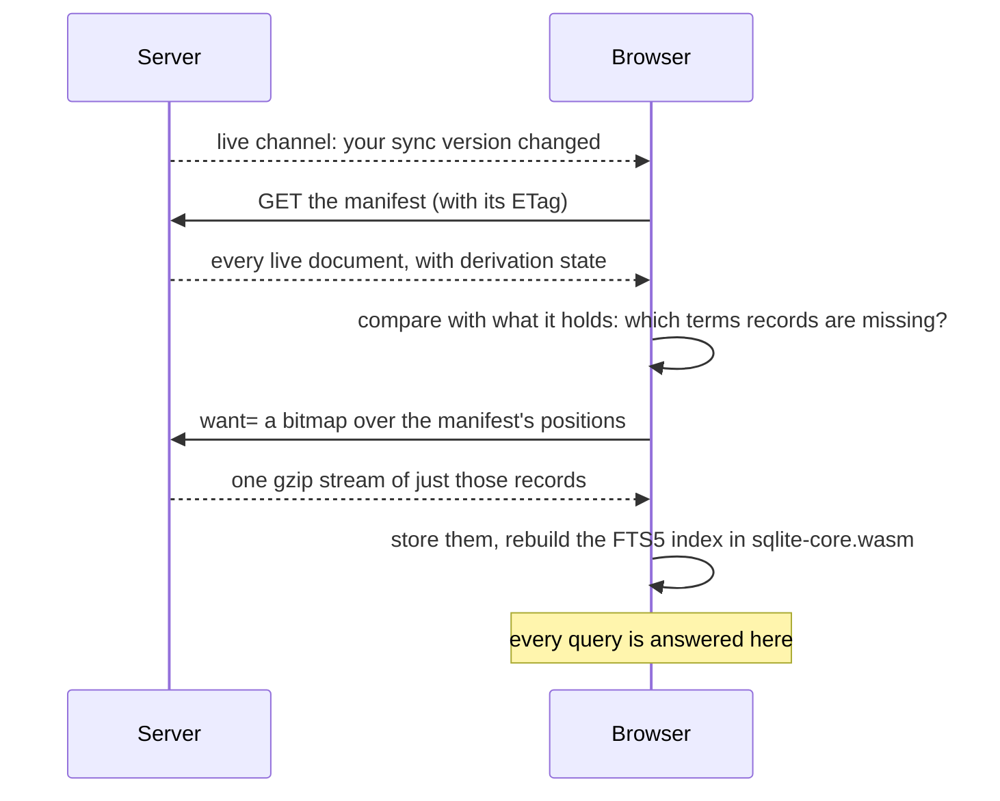

# Search, end to end

There is no search on the server. The server prepares text; the browser
fetches what it lacks, builds the index itself, and answers every query. This
page follows a word from a notebook page to a result, and shows how the
browser paces what it downloads so that a Pi never feels a search. The rules
are in [Search](@/contributor/search-rules.md).

## Step one: the server derives text

When a file arrives, the server derives two files for it: at upload for a
notebook, whose text is already in the file, and on the
[background worker](@/contributor/indexing.md) for a PDF or a text file, whose
text must first be extracted. `terms/` holds, for each page, the words of that page folded
by one tokenizer (`unicode61`, accents removed), one record per page. `text/`
holds the readable text of each page. For a notebook, the words are the
tablet's own handwriting recognition; for a PDF or a text file, the document's
own text. A notebook the tablet never recognised yields nothing, and that
absence is recorded as "derived, and empty", which is different from "not
derived yet".

## Step two: the manifest

The server also keeps, per person, a **manifest**: the complete list of their
live documents, each with its md5, its kind, its derivation state and its
version. It is small and binary, it has an ETag, and it has no tombstones. The
browser replaces its whole set with it, so a document's absence is its
deletion. Any limit or filter on the manifest would be a correctness bug.

## Step three: the browser fetches only what it lacks

A sync that brings something new is announced on the live channel. The
browser fetches the manifest, works out which documents' records it does not
yet hold, and asks for exactly those with a bitmap over the manifest's
positions. The server answers with one stitched gzip stream of the missing
records. The browser keeps the records in its own storage and rebuilds its
FTS5 index, which lives in `sqlite-core.wasm`, the same SQLite the sketch
viewer uses. At the hub's size (45 documents) that rebuild is 4 ms; at a
hundred times that, two thirds of a second. Queries stay under 10 ms.

So the server's part in a search is: serve a small manifest, and serve each
document's terms once. After that, searching costs it nothing.

## Step four: a query

A result must hold every word typed, in its name or in its text. Names
(notebooks, folders, to-dos) are not in the index; the browser matches them by
the index's own rule, so a name and a page agree on what a word is. If nothing
matches as typed, a typo ladder looks for the nearest spellings, because the
corpus is misspelt handwriting recognition, and says so.

Ranking is a weight, not bm25: the index knows one set of words per page, so
it cannot tell a page about a word from a page that mentions it. A document
scores by how many of its pages matched, weighted by what the person wrote
(their notebooks first, then documents they wrote on, then PDFs and text files
as they came), with recency breaking ties.

## Step five: the line under each result

A result quotes the line it matched. That text comes from the `text/` files,
and a search never fetches them: it would make every keystroke a download.
Instead, after each sync, the browser fetches text ahead of time within a
2 MB allowance: every notebook first, then documents written on, then the
rest, newest first, and never more than a quarter of the allowance on one
document. A document too big for the allowance is remembered, by its text
version, so it is not fetched again only to be refused. Excerpts are then cut
from text the browser already holds, as results scroll into view.

## Saying what cannot be searched

Handwriting is searchable only once the tablet recognised it; text typed into
a text box always is. So search tells the person how much is covered: a line
under the results, "Text is searchable on 84 of 161 pages with writing", computed by one query the browser asks for at most
once a minute, which opens into the list of notebooks search cannot fully read
and why. A document still being derived says "still being indexed" and is
asked again, never "No matches".

## Finding inside one document

Opening a notebook and pressing Ctrl+F uses the same machinery at the scale of
one document: the browser fetches that document's `text/` file, unless the
prefetch already holds it, builds a one-document index, and steps through
matches page by page. A notebook, a PDF and a text file differ only in how a
match is drawn and how its page or paragraph is brought into view.

## Trade-offs

### There is no server search

**Problem.** A server-side full-text index held the database lock for 98 s per whole-library ingest on the Pi.

**Decision.** The browser downloads each document's derived text once and answers every query from a local FTS5 index in `sqlite-core.wasm`.

**Cost.** The first search after a sync fetches text; each browser holds its own copy.

**Revisit when** libraries grow past a few thousand documents, where the browser's rebuild starts to show.

### One tokenizer

**Problem.** Two tokenizers, one on each side, would disagree on what a word is.

**Decision.** Server and browser share `unicode61 remove_diacritics 2`; query text reaches the wasm raw.

**Cost.** No language-aware stemming.

**Revisit when** a language's search needs stemming.

### Weights, not bm25

**Problem.** The index holds one set of terms per page, so bm25 can't tell a page about a word from one that mentions it.

**Decision.** Matching pages over the document's pages, weighted by what the person wrote: notes over marked PDFs over other files; recency breaks ties.

**Cost.** A hand-tuned rank.

**Revisit when** the index stores positions. The rules themselves: [Search](@/contributor/search-rules.md).
