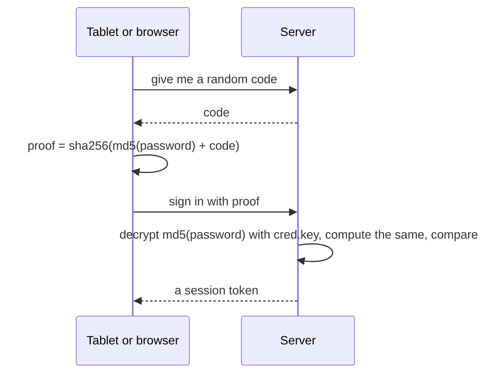

# How sign-in and trust work

Two facts shape Inkhold's security. The tablet's sign-in protocol was not
designed by Inkhold and cannot be changed, and the files the tablet sends are
parsed by code that runs in people's browsers and on the server. This page
explains what follows from each. The rules are in
[Authentication and untrusted content](@/contributor/auth-rules.md).

## A password the server can compute

To check the proof, the server needs `md5(password)` itself. A one-way hash
like bcrypt, which is how most services avoid ever holding a password, is
therefore impossible here. What Inkhold does instead is keep that value
encrypted, with a key (`cred.key`) that lives in a file outside the database
and outside backups unless asked for. A stolen database alone reveals nothing;
a stolen backup alone reveals nothing. The key and the database together would
reveal every `md5(password)`, which is weak, and losing the key means every
account must reset. That is the trade the protocol forces, and the manual says
so plainly to the people running the server.

The browser hashes the password itself, with its own MD5 and SHA-256, because
the browser's built-in crypto exists only on HTTPS and a home network is
usually plain HTTP. The password in plain text never leaves the device.

## Sessions and elevation

A session is a token, stored only as its SHA-256. A tablet's lasts about two
years and ends when the tablet is unlinked; a browser's lasts 14 days idle and
90 in all; a first sign-in that must still change its password gets 15
minutes. The browser's cookie is `HttpOnly` and `SameSite=Strict`, which is
the whole defence against cross-site requests, deliberately.

The admin console can delete another person's notes, so opening it re-runs
the sign-in challenge (nothing replayable crosses plain HTTP) and the
elevation lasts 15 minutes sliding, an hour at most. When it lapses the server
answers a code the app shows as "confirm your password again", not as a dead
session. Every refusal to sign in reads the same, so nobody can learn who the
admins are by trying; and the limits on password guessing are per account,
because a household shares one address.

## Everything from a tablet is hostile

A notebook is a binary file written by a device that may be buggy or
compromised, and the server reads offsets out of it to serve pages. So every
offset is bounds-checked, every decoder uses checked arithmetic (the
WebAssembly build has no overflow traps), and a sketch, which is a SQLite
database, is copied into memory and opened read-only rather than opened as a
file. Only an allowlist of image types and PDF is ever served inline; an SVG
from a tablet, shown inline, would be stored cross-site scripting. And because
blobs are shared across the household, a file that is not yours answers
exactly like a file that does not exist, so nobody can learn what others have
by probing ids.

## Trade-offs

### Passwords stored recoverable, encrypted

**Problem.** The tablet's sign-in proves `md5(password)` against a fresh code, so the server must be able to recover that value: a one-way hash such as bcrypt cannot be used.

**Decision.** `md5(password)` is stored encrypted (XChaCha20-Poly1305, a nonce per row) under `cred.key`, a file kept outside the database. A stolen database or backup alone reveals nothing.

**Cost.** The key and the database together reveal every `md5(password)`, which is weak; losing the key forces every account to reset.

**Revisit when** the device protocol allows a challenge that does not need a recoverable secret.

### No existence oracles

**Problem.** Blobs are shared across the household; answering differently for someone else's file would tell an attacker it exists.

**Decision.** Foreign ids and md5s answer exactly as missing ones do: same status, byte-identical body.

**Cost.** Debugging a 404 can't tell "not yours" from "not there".

**Revisit when** never.

### A tablet's files are hostile

**Problem.** Every byte comes from a device that may be compromised or buggy.

**Decision.** Offsets are bounds-checked, decoders use checked arithmetic, a `.spd` is copied into memory and opened read-only, only an allowlist of types is served inline, and link schemes are allowlisted.

**Cost.** Every new format needs its own bounds work.

**Revisit when** never. The rules themselves: [Authentication and untrusted content](@/contributor/auth-rules.md).
