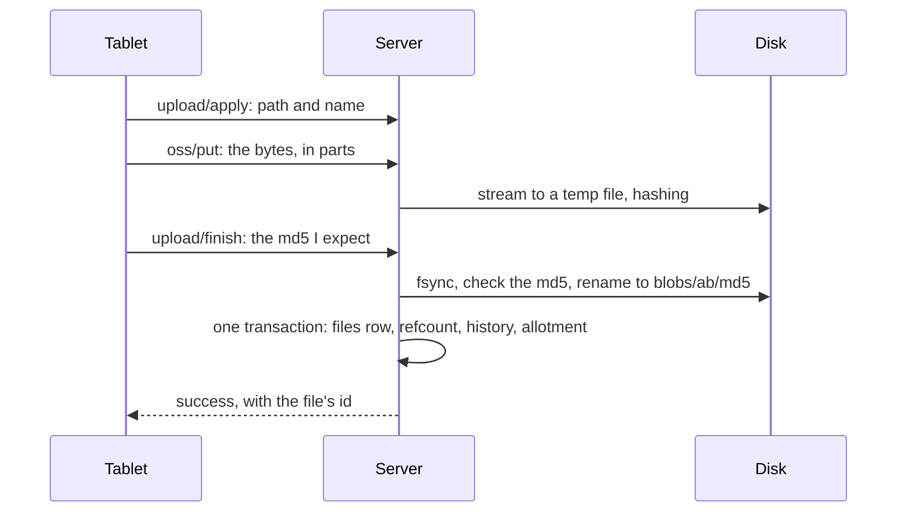
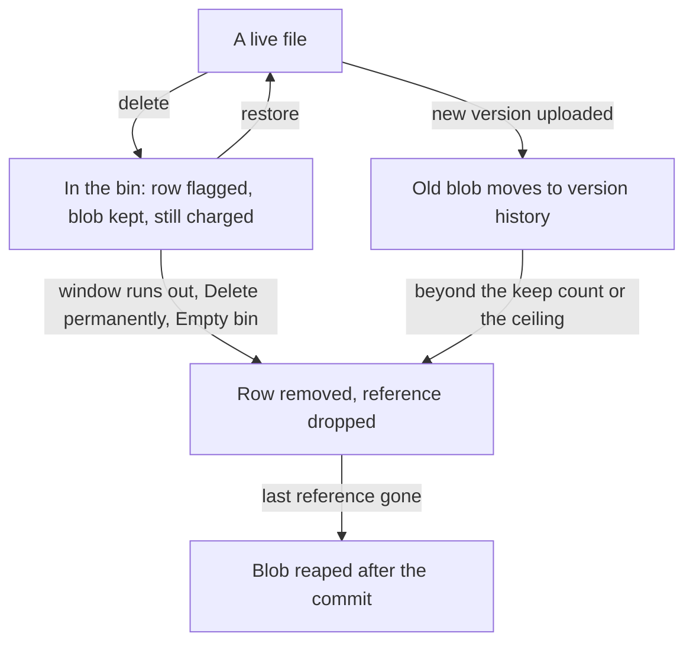

# What happens to a file

A notebook arrives from the tablet, gets a place on disk, is changed and
deleted and restored, and ends up in a backup. This page follows one file
through all of that. The exact rules are in [Storage layout](@/contributor/storage.md).

## Arrival

The tablet uploads in three calls: it announces the file's path and name, sends
the bytes (in parts, when the file is large), and finishes by stating the md5
it expects. While the bytes stream in, the server writes them to a temporary
file and hashes them. Only when the hash matches does the file get a name, and
the name is the hash: `blobs/ab/<md5>`. Two identical files, from two tablets
or two uploads, are one blob.

The order matters. The blob is on disk before the transaction that references
it commits, and a blob is removed only after the transaction that drops its
last reference. A crash can leave an orphan blob, which is swept later; it can
never leave a row that points at bytes that are not there. That one invariant
is what makes retries, restores and backups simple.

Everything the server records about the file (its row, who owns it, how many
rows reference the blob, the version it replaced, the bytes charged to its
owner) happens in that one transaction. Ownership is the security boundary:
every read of a file goes through the owner's id, and a file that belongs to
someone else answers exactly like a file that does not exist.

## Change

When the tablet uploads a new version of the same path, the old blob is not
discarded. Its reference moves to the version history, in the same transaction
that makes the new blob current, so the garbage-collection gate keeps it. A
person's history is bounded twice: by how many versions each file keeps, and
by a ceiling on the whole install's history, enforced by evicting that
person's own oldest versions. Restoring a version is itself an upload that
supersedes the current one, so a restore can be undone.

## Deletion

A delete, from the tablet or the browser, is a flag on the row. Nothing is
released: the blob, its references and its charge against the owner's
allotment all stay. The file sits in the recycle bin, in the place it had,
until its window runs out or someone removes it for good, and restoring it is
the flag flipped back, with the folder chain revived if that was deleted too.

The window is never retroactive: shortening it starts a new window for what
is already in the bin, so an admin can never purge a month of notes with one
setting.

## Backup

A backup is a separate process beside the running server. It copies every
blob the database names into a store of plain files, takes a consistent copy
of the database, and copies whatever that copy names and the store still
lacks. Because blobs never change, every night's snapshot is complete on its
own and adds only what is new. A folder on a NAS, a USB disk or a synced cloud
folder carries it intact, and `verify --deep` proves it can be restored
without restoring it. [How backups work](@/manual/how-backups-work.md) tells
it for the person running the server.

A restore does one thing a plain copy would not: it gives the library a new
identity, so that every tablet notices at its next sign-in and syncs from
scratch, uploading what the restored server lacks instead of deleting what it
holds. [How the tablet syncs](@/contributor/how-sync.md) explains why that is
necessary.

## Trade-offs

### Files are named by their content

**Problem.** Files arrive from tablets that retry, from the browser and from restores; the same notebook often exists twice.

**Decision.** Every file is a blob named by its md5, written to a temp file, fsynced, checked, then renamed. A name is its hash, so an existing blob is known-good and never overwritten, and two identical files share one blob.

**Cost.** A blob's name says nothing about its file; only a `files` row does, so every read goes through ownership (`Files.get`), and quota must count distinct blobs, not files.

**Revisit when** never: it is what makes crashes, retries and backups simple.

### Blob before commit, garbage collection after

**Problem.** A crash between writing bytes and recording them must not leave a row pointing at nothing.

**Decision.** Bytes reach the disk before the transaction that references them commits, and leave only after the transaction that drops the last reference. `reapIfUnreferenced` is the one gate.

**Cost.** A crash can orphan a blob, swept later: some wasted disk for a while.

**Revisit when** never.

### Deleting is two stages

**Problem.** A tablet deletes what it believes was deleted in the cloud; a mistaken delete must be recoverable.

**Decision.** `trash` only marks a row and keeps every reference; `purge`, `emptyBin` and the retention sweep are the only real deletions. Restore is a flag flip, and the window is never retroactive: shortening it never purges a month at once.

**Cost.** Trashed files keep counting against their owner's quota until they go.

**Revisit when** never: it is the product's promise ([Why nothing is deleted outright](@/manual/never-deletes.md)).

### History gives way before an edit does

**Problem.** Refusing a tablet's upload mid-sync is worse than losing an old version.

**Decision.** Under quota pressure an edit evicts the writer's own oldest history-only versions instead of being refused; the install-wide ceiling evicts only the writing user's versions too.

**Cost.** Someone near their allotment keeps fewer versions than the setting promises.

**Revisit when** quota pressure becomes common, and people want to choose what goes.

### Backups are plain files

**Problem.** A household backs up to whatever it has (a NAS share, a USB disk, a Dropbox folder) and never reads cron mail.

**Decision.** A shared store of blobs plus one folder per snapshot, each complete on its own; no packing, no links, nothing a sync client can't carry. Every run is recorded so the library can warn admins when backups stop.

**Cost.** No encryption and no deduplication beyond whole files: a backup is as private as the folder it sits in.

**Revisit when** households ask for encrypted or off-site backups.
