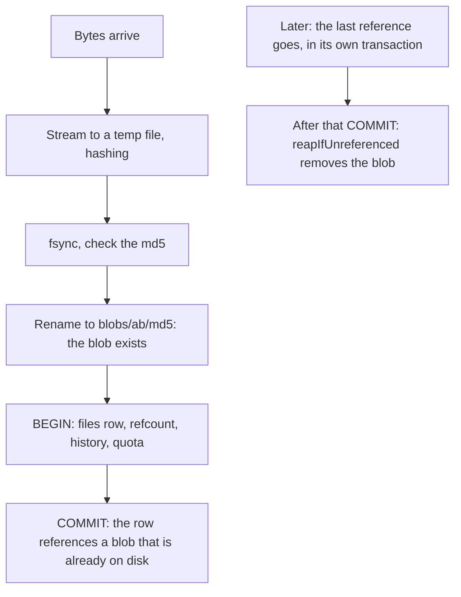

# Storage layout

The rules every write to the library follows: how files are kept on disk, the
recycle bin, allotments, version history, `.mark` pairs and backups. Why they
are this way: [What happens to a file](@/contributor/storage-decisions.md).

## Invariants

- **Every file operation is scoped by `user_id`.** This is the core security
  guarantee. `Files.get` is the ownership boundary for every live read and is
  never relaxed. Two narrow reads exist beside it: `getTrashed` for the bin,
  and `getAnyState` for a tablet's retries.
- **Blobs are named by content.** A blob is stored under the md5 of its bytes.
  The write order is: stream to a temp file while hashing, `fsync`, check the
  md5 against the one expected, then rename atomically to `blobs/ab/<md5>`.
  Because a name is its hash, an existing blob is known to be good and is
  never overwritten.

The order of a write, and of a delete, so a crash never leaves a row that
points at nothing:

- **Blob before commit, garbage collection after commit.** A change to several
  tables runs in one transaction. The blob, and any derived file, is on disk
  before the commit that references it, and is removed only after the commit
  that drops the last reference. A crash can leave a blob nobody references
  (harmless; it is swept), and can never leave a row pointing at missing bytes.
- `reapIfUnreferenced` is the single gate for garbage collection: a blob goes
  when `blobs.refcount` is 0 (no live `files` row) and no `file_history` row
  names it.
- `parent_id` cascades, but a cascade cannot decrement a refcount. Anything a
  delete reaches must be in the set of ids being released first (`releaseIds`,
  `purgeUser`).
- An md5's length is checked wherever a key becomes a path (`finalRel`).
  Offsets read from metadata a tablet wrote are hostile: `readRange` bounds
  every read.
- The server never holds a whole file. It works in windows of
  `blobstore.chunk_len`, 64 KB, fixed at compile time because the buffers live
  on the 1 MiB connection stacks ([Threads and locks](@/contributor/threads-and-locks.md)).

## Recycle bin

- Deleting has two stages. `trash` sets `deleted = 1` and **keeps every blob
  reference**: nothing is released and no allotment is refunded. `purge`,
  `emptyBin` and `sweepBin` delete for good, and together with account deletion
  they are the only callers that decrement references.
- So `restore` flips a flag; it never re-indexes. It also revives the trashed
  chain of ancestors, and a folder's trashed descendants, and renames on a name
  collision with `freeName`, which picks the lowest free ` (n)`. That choice is
  deterministic, so a replayed request converges on the same name.
- `trash` is idempotent. The tablet deletes one entity per request, children
  first, with retries; a retry keeps the first `deleted_at` and does not bump
  the sync version.
- `deleted_path` freezes the file's path at the moment it was trashed, so the
  bin's listing survives a later rename of an ancestor.
- Retention is never retroactive. An entry expires at
  `max(trashed_at, window_changed_at) + window`, so shortening the window never
  purges a month of notes at once.

## Allotments

The code and the config call an allotment a quota.

- `used_bytes` sums the **distinct blobs** a person's rows keep alive, not file
  sizes: two identical files are one blob. A person is charged on their first
  reference to a blob and refunded on their last. Deduplication across people
  is not a discount for either of them.
- A reference is anything that keeps bytes on disk: a `files` row, live or
  trashed, and a `file_history` row. Trashed files keep charging; refunding at
  trash time would let someone exceed their real usage by cycling the bin.
- Under pressure, an edit evicts the person's own oldest history-only versions
  rather than being refused. Refusing in the middle of a sync is worse than
  losing history.
- Refunds are computed from the rows after all writes (`settleRefund`), never
  predicted beforehand.

## Version history

- When a file is superseded, its `file_history` row is written before the
  decrement, in the same transaction, so the garbage-collection gate keeps the
  old blob.
- Two bounds apply. Per file, the owner's `keep`, whose ceiling is
  `@max(keep, max_keep)`. Install-wide, `max_bytes`, enforced by evicting only
  **the writing person's** oldest versions. `keep = 0` turns versioning off.
- Restoring a version goes through the same path as an upload that supersedes
  a file, so the version it displaces is kept: a restore can be undone.

## `.mark` pairs

- The tablet writes a document's annotations to `<the document's full name>.mark`,
  with the extension appended. A pair lists as one row, the document's, which
  carries `annotationsId`.
- The rule is relational, not a list of extensions: the same folder, the exact
  stem, no chains (`a.mark.mark`), neither half a folder, the same `deleted`
  state. One SQL rule (`mark_pairing.zig`) serves every listing, and `pairOf`
  is the one entry point for mutations, so what a listing folds together is
  exactly what a trash, restore, move or purge carries along.
- A pair moves and renames as one. Ink is never composited onto a trashed
  document: a read of a trashed file selects `NULL` for its mark.

## Backups

`inkhold backup` (`services/backup.zig`) makes a backup a household can keep:
a folder of plain files that a NAS share, a USB disk or a Dropbox folder
carries intact. It is a separate process running beside the server; cron or
systemd schedules it (`contrib/systemd/` has a timer, shipped disabled, and the
Docker image runs busybox's crond beside the server when a volume is mounted at
`/backup`).

- **Layout.** One shared store, `blobs/ab/<md5>[.gz]`, and one folder per
  snapshot named `YYYY-MM-DDTHHMMSSZ/`, holding `inkhold.db.gz`,
  `manifest.txt` and, when asked for, `cred.key`. Blobs never change, so every
  snapshot is complete on its own: a restore needs one snapshot and the store,
  never a chain. There is no packing and there are no links: each run only adds
  new files, which is what sync clients are good at uploading.
- **Consistency.** First copy every blob the live `blobs` table names; then
  `VACUUM INTO` a private copy of the database; then copy whatever that copy
  names and the store still lacks. A blob missing from the live store at that
  point was uploaded and purged inside the window, and the snapshot is taken
  again. Taking the snapshot first would be wrong on its own: blob-before-commit
  covers additions, not purges. References come from `blobs` only, the
  garbage-collection gate's own record, which already counts the bin and
  history.
- **Atomic.** A snapshot is built as `<name>.partial/`, its manifest is written
  last, and the folder is renamed into place. A manifest is refused when it is
  cut short, out of order or disagrees with its header, and `prune` reads every
  kept manifest to its end before deleting anything. One writer per folder,
  held by an `O_EXCL` lock file rather than `flock`, which SMB and synced
  folders do not honour; a lock older than six hours is stale.
- **Place.** The folder must already exist: a missing one is usually an
  unmounted NAS, and creating it would fill the SD card. It must not be inside
  the live data, and sharing a filesystem with the live data gets a warning.
  The private snapshot is built in `<data_dir>/backup-tmp`, never in the
  watched folder.
- **Compression.** gzip level 1 per blob, kept only when it saves 10%; on real
  notebooks and PDFs a higher level buys nothing. The md5 names the
  decompressed bytes. `gzfile.inflate` checks gzip's trailer, because
  `flate.Decompress` does not.
- **Footprint.** About 4 MB of anonymous memory whatever the library's size.
  md5s are streamed 256 per statement (short read transactions, so the
  server's WAL checkpoints keep working), buffers share one scratch area of
  about 420 KB, and each SQLite connection gets a 256 KB page cache: it reads
  each page once, and a 1 MB cache pushed a Pi 1 past the budget at 16,000
  blobs. The process drops itself to nice 19 and the idle I/O class, and reads
  at 4 MiB/s by default. `scripts/footprint.py` pins all of this, at two
  library sizes.
- **`cred.key`** stays out unless asked for, and the snapshot's legacy
  `password_md5` column is blanked, so a backup alone holds no usable
  credential. `restore` uses the snapshot's key if it has one; otherwise the
  install's own key, if it decrypts the accounts; otherwise a new key and a
  temporary password per account.
- **Restore** never writes over a database, refuses to run while the port
  answers, verifies first, and renames the database into place last. A tablet
  that resumes syncing against an older server deletes what it holds and the
  server lacks (issue #21's mechanism, seen on a Nomad), and signing it out is
  not enough, because it keeps its sync records across a sign-out. So a restore
  signs every tablet out **and** gives the library a new id
  ([Device protocol](@/contributor/device-protocol.md)), which makes each tablet
  start from scratch at its next sign-in. Thumbnails and search text are rebuilt
  by the server ([Indexing and derived data](@/contributor/indexing-rules.md)).
- **The notice.** Households never read cron's mail, so `create` and `verify`
  record every run, good or failed, in `backup_runs` (one row per folder,
  schema v17), whenever the database is reachable; `restore` empties the table.
  `backup/status.zig` judges it: a folder whose last run failed is `failed`,
  always; no success anywhere is `never`, unless an admin has said they back up
  another way; the newest success anywhere older than `backup_warn_after_hours`
  (48) is `late`, so a weekly USB disk beside a nightly NAS is fine. Admins see
  the verdict as one line in the library, shown without elevation so it never
  hides behind a prompt, and the admin console's Server panel lists each folder.
