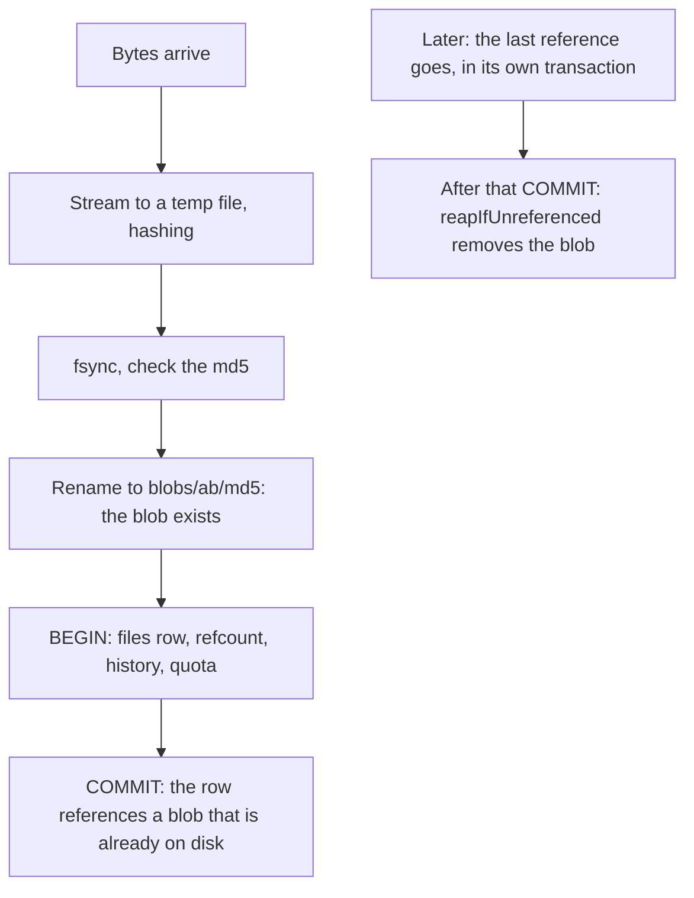

# Storage layout

The rules every write to the library follows: how files are kept, the recycle bin, quota, version history, `.mark` pairs and backups. Why they are this way: [Storage decisions](@/contributor/storage-decisions.md).

## Invariants

- Every file operation is scoped by `user_id`. This is the core security
  guarantee; `Files.get` is the ownership boundary for every live read and is
  never relaxed. Narrow separate reads exist for the bin (`getTrashed`) and for
  device retries (`getAnyState`).
- Blobs are content-addressed by md5. Write order: stream to a temp file while
  hashing → fsync → verify the expected md5 → atomic rename to `<ab>/<md5>`. A
  name is its hash, so an existing blob is known-good and never overwritten.
The order of a write, and of a delete, so a crash never leaves a row that
points at nothing:

- **Blob before commit, GC after commit.** Multi-table mutations run in one
  transaction; the blob (and any derived file) is on disk before the commit that
  references it and is removed only after the commit that drops the last
  reference. A crash can orphan a blob (harmless, swept), never leave a row
  pointing at missing bytes.
- `reapIfUnreferenced` is the single GC gate: `blobs.refcount = 0` (live
  `files` rows) and no `file_history` row.
- `parent_id` cascades, but cascades cannot decrement refcounts: anything a
  delete reaches must be in the decref set first (`releaseIds`, `purgeUser`).
- md5 lengths are checked where a key becomes a path (`finalRel`); offsets read
  from device-written metadata are hostile (`readRange` bounds every read).
- The server never holds a whole file: `blobstore.chunk_len` (64 KB) windows,
  compile-time because buffers live on the 1 MiB connection stacks ([§3.1](@/contributor/threads-and-locks.md#threads-and-locks)).

## Recycle bin

- Two stages. `trash` sets `deleted = 1` and **holds every blob reference** —
  nothing is released or refunded. `purge`/`emptyBin`/`sweepBin` hard-delete and
  are the only decref callers besides account deletion.
- So `restore` is a flag flip, not a re-index. Restore also revives the trashed
  ancestor chain and a folder's trashed descendants, and auto-renames on
  collision (`freeName`: lowest free ` (n)`, deterministic so replays converge).
- `trash` is idempotent: the device deletes one entity per request, children
  first, with retries. A retry keeps the first `deleted_at` and does not bump the
  sync version.
- `deleted_path` freezes the path at trash time, so the bin listing survives
  later ancestor renames.
- Retention is not retroactive: an entry expires at
  `max(trashed_at, window_changed_at) + window`, so shortening the window never
  purges a month of notes at once.

## Quota

- `used_bytes` sums the **distinct blobs** a user's rows keep alive, not file
  sizes: two identical files are one blob. Charge on a user's first reference,
  refund on their last. Dedup across users is not a discount.
- A reference is anything keeping bytes on disk: `files` rows, live or trashed,
  and `file_history` rows. Trashed files keep charging (refunding at trash time
  would let cycling the bin exceed real usage).
- Under quota pressure an edit evicts the user's oldest history-only versions
  rather than being refused; refusal mid-sync is worse than losing history.
- Refunds are computed from the rows after all writes (`settleRefund`), never
  predicted.

## Version history

- On supersede, the `file_history` row is written before the decref, in the
  same transaction, so the GC gate keeps the old blob.
- Bounds: per-file `keep` (the owner's policy, ceiling `@max(keep, max_keep)`),
  then install-wide `max_bytes`, enforced by evicting **the writing user's**
  oldest versions only. `keep = 0` disables versioning.
- Restoring a version goes through the upload supersede path, so the displaced
  current is retained: restore is undoable.

## `.mark` pairs

- The device writes a document's annotations to `<document full name>.mark`
  (extension appended). A pair lists as one row, the document's, which carries
  `annotationsId`.
- The rule is relational, not an extension list: same folder, exact stem, no
  chains (`a.mark.mark`), neither half a folder, same `deleted` state. One SQL
  rule (`mark_pairing.zig`) is shared by every listing; `pairOf` is the one
  entry point for mutations, so what a listing folds is exactly what a
  trash/restore/move/purge carries.
- A pair moves and renames as one. Ink is never composited onto a trashed
  document (trashed reads select `NULL` for the mark).

## Backups

`inkhold backup` (`services/backup.zig`) is for a household: a folder of plain
files that a NAS share, a USB disk or a Dropbox folder carries intact. It is a
separate process beside a running server; scheduling is cron's or systemd's
(`contrib/systemd/` has a timer, shipped disabled; the Docker image runs
busybox crond beside the server when a volume is mounted at `/backup`).

- **Layout.** One shared store, `blobs/ab/<md5>[.gz]`, and one directory per
  snapshot (`YYYY-MM-DDTHHMMSSZ/`: `inkhold.db.gz`, `manifest.txt`, optionally
  `cred.key`). Blobs never change, so every snapshot is complete on its own:
  restoring needs one snapshot and the store, never a chain. No packing, no
  links: each run adds only new files, which is what sync clients upload.
- **Consistency.** Copy every blob the live `blobs` table names; `VACUUM INTO`
  a private copy; copy what that copy names and the store still lacks. A blob
  gone from the live store then was uploaded and purged inside the window, so
  the snapshot is retaken. Snapshot-first alone is wrong: blob-before-commit
  ([§2.1](@/contributor/storage.md#invariants)) covers additions, not purges. References come from `blobs` only, the
  GC gate's record, which already counts the bin and history.
- **Atomic.** A snapshot is built as `<name>.partial/`, the manifest written
  last, then renamed. A manifest is refused when cut short, out of order or
  disagreeing with its header; `prune` reads every kept one to its end before
  deleting anything. One writer per directory: an O_EXCL lock file, not
  `flock` (which SMB and synced folders do not honour), stale after six hours.
- **Place.** The directory must already exist (a missing one is usually an
  unmounted NAS; creating it would fill the SD card) and must not be inside
  the live data. Sharing a filesystem with it is warned about. The private
  snapshot lives in `<data_dir>/backup-tmp`, never in the watched folder.
- **Compression.** gzip level 1 per blob, kept only when it saves 10%: on real
  notebooks and PDFs higher levels buy nothing. md5 names the decompressed
  bytes; gzip's trailer is checked by `gzfile.inflate`, since
  `flate.Decompress` does not.
- **Footprint.** 4 MB of anonymous memory whatever the library's size: md5s
  are streamed 256 per statement (short read transactions, so the server's WAL
  checkpoints), buffers sit in one ~420 KB scratch, each SQLite connection
  gets a 256 KB page cache (it reads each page once; 1 MB pushed a Pi 1 past
  the budget at 16,000 blobs). The process drops to nice 19 and the idle I/O class and reads at
  4 MiB/s by default. `scripts/footprint.py` pins all of it, at two sizes.
- **`cred.key`** stays out unless asked for, and the snapshot's legacy
  `password_md5` column is blanked, so a backup alone holds no usable
  credential. `restore` uses the snapshot's key, else the install's own if it
  decrypts the accounts, else a new key and a temporary password per account.
- **Restore** never writes over a database, refuses while the port answers,
  verifies first, and renames the database in last. A tablet that resumes
  syncing against an older server deletes what it holds that the server lacks
  (#21's mechanism; seen on a Nomad), and signing it out is not enough: it
  keeps its sync records across sign-out. So restore signs every device out
  AND gives the library a new id ([§4](@/contributor/device-protocol.md)), which makes each tablet start from
  scratch at its next sign-in. Thumbnails and search text are rebuilt by the
  server ([§8.3](@/contributor/indexing-rules.md)).
- **The notice.** Households never read cron mail. `create` and `verify`
  record every run, good or failed, in `backup_runs` (one row per directory,
  schema v17), whenever the database is reachable; `restore` empties it.
  `backup/status.zig` judges it: a directory whose last run failed is
  `failed`, always; no success anywhere is `never`, unless an admin said they
  back up another way; the newest success anywhere older than
  `backup_warn_after_hours` (48) is `late`, so a weekly USB disk beside a
  nightly NAS is fine. Admins see it as one line in the library (no elevation,
  or it would hide behind a prompt); the Server panel lists each directory.
