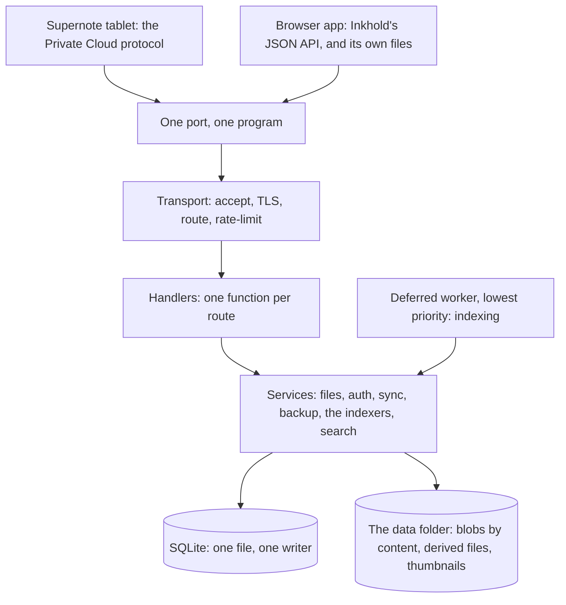

# The shape of the system

Inkhold is one program on a computer at home. It speaks to two kinds of
client, the Supernote tablet and the browser, on one port, and it keeps
everything on its own disk. The first thing to understand about it is where
the work happens: the server stores and moves bytes, and the browser does
everything that costs effort. That split is what lets a Raspberry Pi 1 from
2014 serve a household, and it shapes almost every other decision in this
manual.

## Three faces, one port

The same port answers three kinds of caller, told apart by the scope their
session carries. The tablet speaks the protocol of Supernote's own Private
Cloud, which Inkhold learnt by watching a real tablet. The browser app speaks
a JSON API of Inkhold's own. And the browser app's files themselves (HTML,
scripts, the WebAssembly decoders) are served as static files. A caller with a
tablet's session cannot call the browser's routes, or the other way round:
crossing a scope is a 403.

Inside, the server is layered, and an import only ever points down: the
transport knows nothing of files, the file service knows nothing of HTTP.
[Where things live](@/contributor/where-things-live.md) is the map.

## The server moves bytes; the browser does the work

When you open a notebook page in the browser, the server does not draw it.
It looks up, in an index it built when the file arrived, where that page's
layers sit inside the file, and streams those bytes out. The browser decodes
them with a small WebAssembly decoder and paints the page. The same holds for
a PDF (MuPDF runs in the browser), for search (the browser holds the index and
answers every query), and for export (the PDF or image is made in the browser
and downloaded, never uploaded).

So a busy evening in a household, four people reading and searching and two
tablets syncing, costs the server about 15% of a Pi 1's single core and a few
megabytes of memory. The devices people already hold do the rest.

## The budget

The design target is the weakest machine a household might run it on: a
Raspberry Pi 1 B+, one ARMv6 core, and a ceiling of about 50 MB of anonymous
memory. If it runs there, it runs anywhere. Many choices that look unusual
elsewhere in this manual (no server-side search, no thread per connection,
indexing deferred to a background worker, 64 KB windows instead of whole
files) come from that budget, and each is measured against it
([Measure memory and speed on a Pi](@/contributor/measure-on-a-pi.md)).

## A household, not a fleet

Inkhold serves a handful of people and tablets. One SQLite file with one
writer is enough, and it buys simplicity everywhere: one transaction covers a
whole change, backups are a copy of one file plus the blobs, and there is
nothing to coordinate between machines. It does not scale past a household,
and that is by design.

## Trade-offs

### One program, one port

**Problem.** A household should not run a stack: the official private cloud wants several services, a database server and gigabytes of memory.

**Decision.** One binary serves the tablet's sync, the browser's API and the app's files on one port, kept apart by caller scope (`.device`, `.controlplane`, `.pending`, `.public`); crossing a scope is a 403. One SQLite file, one writer.

**Cost.** Everything shares one process and one database lock; a slow route can be felt by the others (see [Concurrency decisions](@/contributor/concurrency-decisions.md)).

**Revisit when** a household needs more than one machine to serve it, which nobody has asked for.

### The server moves bytes; the browser does the work

**Problem.** Drawing a page, rendering a PDF, indexing and exporting each cost more than a Raspberry Pi 1 can spare for a household.

**Decision.** All of it runs in the browser, on WebAssembly decoders. The server never rasterises: it plans byte ranges from its index and streams them.

**Cost.** The browser downloads decoders (MuPDF alone is about 5 MB), a first visit is heavier, and an old phone draws more slowly than a server would.

**Revisit when** the target hardware is no longer a single ARMv6 core, or most readers are on devices too weak for the decoders.

### A Raspberry Pi 1 B+ is the budget

**Problem.** If it runs on the weakest hardware a household might have, it runs on anything.

**Decision.** One ARMv6 core and about 50 MB of anonymous memory (`RssAnon`; `VmRSS` also counts the mapped database and binary). No 64-bit atomics on ARMv6, so counters are `u32`/`usize`. Most choices that look unusual elsewhere in this manual come from this budget.

**Cost.** Simple designs are sometimes passed over for cheaper ones, and every change is measured on the Pi (see [Measure memory and speed on a Pi](@/contributor/measure-on-a-pi.md)).

**Revisit when** the Pi 1 stops being a machine anyone runs, and the measurements show the budget no longer shapes the code.

### A household, not a fleet

**Problem.** Multi-tenant designs (sharding, queues, many writers) cost memory and complexity a home server never repays.

**Decision.** A handful of devices and browsers, one SQLite file, one writer.

**Cost.** It doesn't scale past a household, by design.

**Revisit when** someone needs to serve many households from one install.
