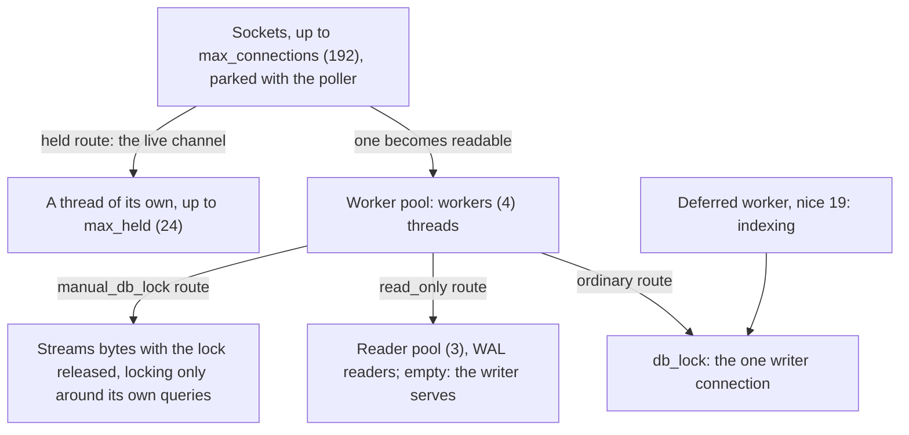

# Threads and locks

Which thread may do what, the database lock and the route flags. Why: [Concurrency decisions](@/contributor/concurrency-decisions.md).

## Threads and locks

How a request finds a thread, and how a thread finds the database:

- **Threads follow requests, not sockets.** The acceptor parks every socket
  with the poller (`http/poller.zig`, one `poll` thread); a readable one goes
  to a worker from a fixed pool (`workers`, 4) which serves it and parks it
  again. A parked plaintext socket is one `Conn` (`http/conn.zig`, ~34 KB) and
  no thread; `max_connections` (192) is therefore an fd budget. Only a `held`
  route (the SSE channel) gets a thread of its own, capped by `max_held`;
  sockets idle past `idle_timeout_s` are closed. Worker and held-stream stacks
  are 1 MiB, bisected empirically against a live 32 MB upload; re-bisect if
  the upload path's frames change. `scripts/footprint.py` pins these numbers in CI.
- One shared SQLite writer connection, serialised by `db_lock` around the whole
  handler. `std.Io.Mutex` is not reentrant: anything that takes `db_lock`
  itself (`indexSnapshot`, `pending.Pulse`) must not be called inside a
  `lockDb` bracket.
- **Lock order:** `Files.thumb_repair` first, `db_lock` second. `Pulse.mutex`
  is held across its recount including `db_lock`; nothing takes them reversed.
- Once a response head is sent, a failure returns without `body.end()` (it
  asserts the full `Content-Length` and panics in safe builds); the closed
  connection is the truncation signal.

## Route flags

- `manual_db_lock`: streaming routes (`/oss/get`, `/oss/put`, page bytes, raw
  file, thumbnails, uploads, SSE) lock only around their own DB touches so a
  multi-MB transfer never holds the global lock. Their plans own inline copies
  so nothing borrows SQLite statement memory past the unlock.
- `read_only`: runs on a pooled `SQLITE_OPEN_READONLY` connection without
  `db_lock`. The flag is a claim about the whole call path, not the HTTP method
  (device POSTs pure reads; self-healing listings write, so they stay on the
  writer). Defaults to false. An integration audit probes every flagged route on
  a real reader and on the writer with an update hook armed.
- Banned pairs, asserted at comptime: `read_only` + `manual_db_lock`, and
  either one + `require_admin` (elevation renewal is an UPDATE on the automatic
  path).

## Reader pool

- WAL allows many readers and one writer; one shared connection threw that away
  (a 3.4 s search on the Pi blocked everything). Readers win even on one core,
  through preemption.
- Borrow per operation, never per request: SSE streams live for minutes.
  Exhaustion returns null and the caller falls back to the writer under
  `db_lock` — the pool is an optimisation, its size (3) is tuning.
- Readers open after the writer has created and migrated the DB. The
  per-connection `temp` schema stays writable on a reader (used for the term
  fold scratch).

## Deferred work

- Indexing on the upload path held the connection for the whole derive (48–60 s
  for a 16 MB `.txt` on the Pi), so post-upload work runs on one background
  worker at nice 19.
- **The job store is a query, not a queue.** Each tenant is a FROM/WHERE naming
  blobs that still owe work. That buys restart safety, idempotence (all writes
  are upserts) and live priority, with no claims or status column.
- Tenant shape: re-check under the lock → derive off the lock → verdict under
  the lock. **The derived file is the fact**: files are written before the
  verdict, never the reverse, or a crash marks an underived blob done for ever.
- A tenant that can never succeed records a verdict (over-cap, broken PDF, no
  text), or it is retried for ever. Each blob is offered at most once per
  drain; a 30 s idle tick paces retries.
- The tenant FROM/WHERE fragments are shared by the worker and the "indexing
  pending" count (`pending.zig`), which may only add bounds, so the two cannot
  disagree. Signal the worker after COMMIT, never inside the transaction.
