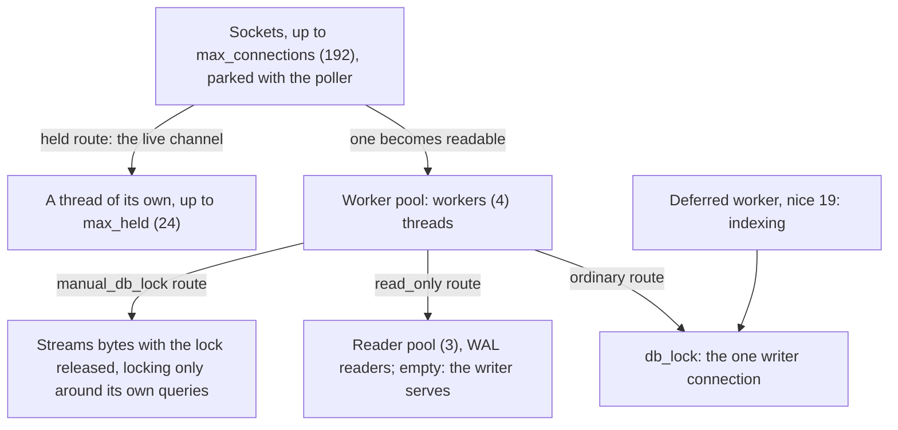

# Threads and locks

Which thread may do what, the database lock, and the flags a route declares.
Why it is this way: [Concurrency decisions](@/contributor/concurrency-decisions.md).

## Threads and locks

How a request finds a thread, and how a thread finds the database:

- **Threads follow requests, not sockets.** The acceptor parks every socket
  with the poller (`http/poller.zig`, one thread calling `poll`). When a socket
  becomes readable, a worker from a fixed pool (`workers`, 4) serves it and
  parks it again. A parked plaintext socket is one `Conn` (`http/conn.zig`,
  about 34 KB) and no thread, so `max_connections` (192) is a budget of file
  descriptors, not of memory. Only a `held` route, the live channel, gets a
  thread of its own, capped by `max_held`. A socket idle for longer than
  `idle_timeout_s` is closed.
- Worker and held-stream stacks are 1 MiB, a size found by bisecting against a
  live 32 MB upload. Bisect again if the upload path's frames change.
  `scripts/footprint.py` pins these numbers in CI.
- **One writer connection,** shared, serialised by `db_lock` around the whole
  handler. `std.Io.Mutex` is not reentrant, so anything that takes `db_lock`
  itself (`indexSnapshot`, `pending.Pulse`) must not be called inside a
  `lockDb` bracket.
- **Lock order:** `Files.thumb_repair` first, then `db_lock`. `Pulse.mutex` is
  held across its recount, `db_lock` included; nothing takes these in the other
  order.
- Once a response head has been sent, a failure returns without calling
  `body.end()`, which asserts that the full `Content-Length` was written and
  panics in safe builds. The closed connection is the signal that the response
  was cut short.

## Route flags

- **`manual_db_lock`.** A streaming route (`/oss/get`, `/oss/put`, page bytes,
  the raw file, thumbnails, uploads, the live channel) takes the lock only
  around its own database touches, so a transfer of many megabytes never holds
  the global lock. Such a route's plan owns copies of what it read, so nothing
  borrows SQLite statement memory past the unlock.
- **`read_only`.** The route runs on a pooled `SQLITE_OPEN_READONLY`
  connection without `db_lock`. The flag claims that the whole call path only
  reads; it says nothing about the HTTP method. A tablet's POSTs can be pure
  reads, and a listing that heals its own index writes, so it stays on the
  writer. The default is false. An integration audit probes every flagged
  route on a real reader, and on the writer with an update hook armed.
- **Banned pairs,** asserted at compile time: `read_only` with
  `manual_db_lock`, and either of them with `require_admin`, because renewing
  an admin's elevation is an UPDATE on the automatic path.

## Reader pool

- WAL lets many readers run beside one writer. One shared connection threw
  that away: a 3.4 s search on the Pi blocked everything. Readers win even on
  one core, through preemption.
- A reader is borrowed per operation, never per request: a live-channel stream
  lives for minutes. When the pool is exhausted the borrow returns null and the
  caller falls back to the writer under `db_lock`. The pool is an optimisation;
  its size, 3, is tuning.
- Readers open after the writer has created and migrated the database. A
  reader's per-connection `temp` schema stays writable, which the term-folding
  scratch table uses.

## Deferred work

- Indexing on the upload path held the connection for the whole derivation,
  48 to 60 s for a 16 MB `.txt` on the Pi. So work that follows an upload runs
  on one background worker at nice 19.
- **The job store is a query, not a queue.** Each tenant is a FROM/WHERE that
  names the blobs still owing its kind of work. That gives restart safety,
  idempotence (every write is an upsert) and live priority, with no claims and
  no status column.
- A tenant's shape: re-check under the lock, derive with the lock released,
  record the verdict under the lock. **The derived file is the fact.** Files
  are written before the verdict, never after, or a crash would mark an
  underived blob as done for ever.
- A tenant that can never succeed records a verdict (over the cap, a broken
  PDF, no text), or it would be retried for ever. Each blob is offered at most
  once per drain, and a 30 s idle tick paces the retries.
- The tenants' FROM/WHERE fragments are shared with the "indexing pending"
  count (`pending.zig`), which may only add bounds to them, so the two can never
  disagree. The worker is signalled after COMMIT, never inside the transaction.
