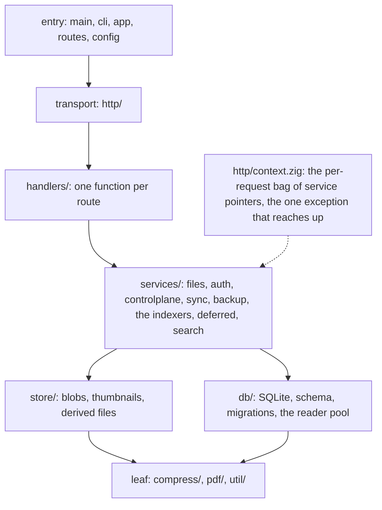

# Where things live

The repository's map: the server's layers, how a module splits when it grows,
how things are named, and how the browser app is laid out.

## The server's layers

The directories are layers. An import points down the list, never up: a file
in `services/` may import `store/` and `db/`, and nothing in `store/` knows that
`http/` exists. The one deliberate exception is `http/context.zig`, the
per-request bag of service pointers that every handler receives.

The layers, with imports pointing down:

| Layer | Directory | Holds |
|---|---|---|
| entry | `backend/main.zig`, `cli.zig`, `cli/`, `app.zig`, `routes.zig`, `config.zig` | Process start, the command-line grammar, the composition root, the route table. |
| transport | `http/` | The accept loop and TLS, the router, the request context, replies, multipart, static files, rate limits, live-channel admission, lock histograms. |
| handlers | `handlers/` | One function per route, in `auth`, `device/`, `controlplane/` and `admin`: thin HTTP shells that parse, call a service and reply. |
| services | `services/` | The domain: `files` (the tree, the bin, allotments, history), `auth/`, `controlplane` (the browser's JSON shapes), `sync`, `settings`, `backup`, the indexers (`note_index`, `spd_index`, `txt_index`, `pdf_index`, `pdf_text`, `ink_scan`, `derive_search`), `deferred` (the worker), `pending`, `search/`. |
| stores | `store/` | Content-addressed bytes on disk: blobs, thumbnails, derived files. |
| db | `db/` | The SQLite wrapper, the schema and its migrations, the reader pool. |
| leaf | `compress/`, `pdf/`, `util/` | Code that depends on nothing else here: the gzip stitcher, the MuPDF shims, small helpers. |
| tests | `test/http/` | Integration tests over the in-memory transport. Unit tests sit beside the code (below). |
| benches | `bench/` | Measurement programs, built on demand, never shipped. |

Within `services/`, the indexers sit below `files`, which calls them inside its
transactions, and `controlplane`, `sync` and `auth` sit above it.

Each SQL table has one owner, and only the owner writes it. `files` owns
`files`, `blobs`, `capacity`, `file_history`, `sync_state` and
`upload_sessions`. `auth` owns `users`, `sessions`, `devices` and
`user_devices`. `settings` owns `settings`. `note_index` owns `note_index` and
`note_page_index`, where the other indexers record their per-blob verdict
through it ([Indexing and derived data](@/contributor/indexing-rules.md)).
`spd_index` owns `spd_index`. Any module may read a table it does not own,
joining through `files` for ownership ([Storage layout](@/contributor/storage.md)).

## A module in parts

A module is one file, `x.zig`, until it outgrows 500 lines. Then `x.zig` stays
as the façade (the types, the struct, and `pub const f = part.f;` for each
exported function, grouped under one header per part) and the parts move to
`x/`: `x/part.zig` holds the code, `x/part_test.zig` its tests, `x/fixture.zig`
what the tests share, and `x/internal.zig` what the parts share and nothing
else calls. Nothing becomes `pub` for a test's sake: a test that needs a
private helper stays in the file, under `// ---- tests of private helpers ----`
at the end. `files.zig` with `files/` is the model.

## Naming

- A handler is named after its resource, not its face: `controlplane.tree`,
  `admin.listUsers`, `device.listFolder`. The face is the module.
- One import alias per module, used everywhere: `filesmod`, `authsvc`,
  `context`, `noteindex`, `blobstore`, `thumbstore`, `derivedstore`, `sqlite`,
  `schema`.
- A section header, `// ---- name ----`, sits above code. A header with nothing
  under it is deleted, not kept.
- Every file starts with a `//!` line saying what it is for. Every `pub fn`
  that is not a one-line wrapper carries a `///` saying what the caller may
  assume.

## The browser app

`webapp/src/` is laid out by role: `api/` (the server client and its fake),
`core/` (shared types), `render/`, `search/`, `export/`, `cache/`, `sync/`,
`ui/` (DOM helpers) and `pages/` (the screens). A screen with more than one
module gets its own folder, `pages/<feature>/`, with the entry module named
after the feature (`pages/library/library.ts`); a single-file screen stays at
`pages/`. Unit tests live under `tests/unit/` and end-to-end specs under
`tests/e2e/`, mirroring the source's names.

A screen that outgrows one file is not cut into closures fed by thunks. It gets
one typed context object (`LibraryCtx`, `ReaderCtx`, `PdfViewerCtx`, `TodoCtx`)
that names everything its parts share, built once in dependency order by the
screen's entry module. Each part is a `createX(ctx)` that returns a named
interface and reads a member only when one of its functions runs. The context
file states the order rule, and the entry module is the only place that has to
get it right.

Stylesheets are a list of rules, so the 500-line target is for code, not for
them. `styles.css` is an ordered manifest and the order is load-bearing. A
sheet that grows is split by component (`09-admin.css`, `09b-admin-panels.css`),
with the continuation imported right after its base so the cascade is
unchanged.
