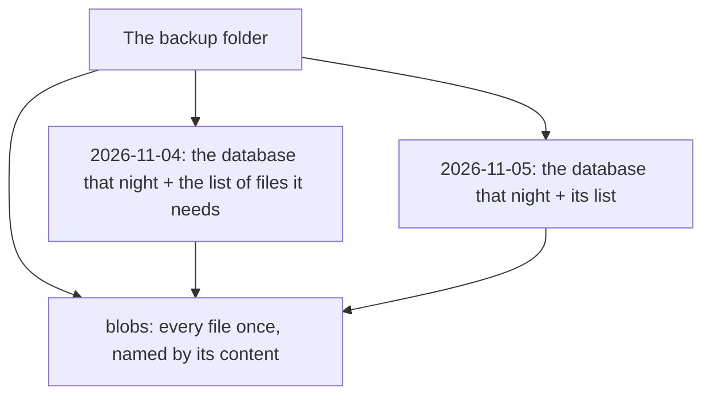

# How backups work

An Inkhold backup is a folder of ordinary files that any copying tool, NAS or
cloud folder carries intact, and that a restore needs nothing else to read.

## Snapshots and one store of files

The folder holds one store of files and a folder per snapshot:

- **The store** keeps every file once, named by its content. A notebook that
  hasn't changed since last night isn't copied again.
- **A snapshot** is a copy of the database at that moment, and a list of the
  files it needs from the store.

What the backup folder holds: one store of files, and a folder per night that
points into it.

So each night's backup copies only what is new and stays small, yet every
snapshot is complete on its own: restoring one needs that snapshot and the
store, never a chain of earlier ones. `--keep=7` keeps the newest seven and
removes files no kept snapshot needs.

## Safe while the server runs

A backup runs beside a running server, at low priority, without stopping
syncs. It copies the files first, then a consistent copy of the database, and
then any file that copy names and the store still lacks. A snapshot appears
only once complete: an interrupted one is never mistaken for a backup.

## Checking without restoring

`inkhold backup verify` checks that each snapshot is whole and its list of files
present. `--deep` also re-reads every file and the database, page by page: it
proves the backup can be restored without restoring it. The nightly backup
runs the quick check on each new snapshot; the deep one runs weekly, because a
file can go bad on the disk long after it was written.

## What it leaves out

`cred.key`, unless you ask for it with `--include-cred-key`, so a stolen
backup reveals no passwords. Restoring without it still brings back every
notebook; each account gets a temporary password.

[Back up automatically](@/manual/back-up.md) has the commands.
