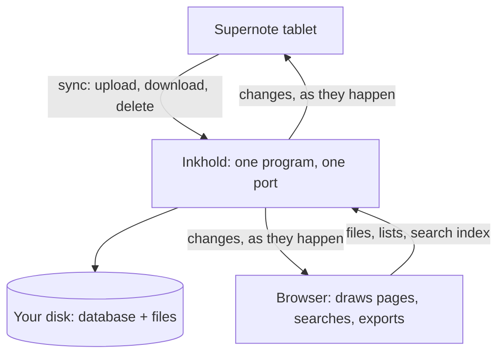

# How Inkhold works

Inkhold splits the work in two. The server, at home, stores your files and
answers the tablet. Your browser, on whatever device you hold, does
everything that takes effort: drawing pages, searching, exporting. That split
is why a Raspberry Pi from 2014 can serve a household.

The diagram shows who talks to whom: the tablet and the browser both talk to
the one Inkhold program, which keeps everything on its own disk.

## The server

One program, listening on one port, for three things: the tablet's sync (the
same protocol Supernote's own Private Cloud speaks), the browser app's
requests, and the browser app's own files. It keeps a database and your files
on its disk, and reaches nothing outside your home.

What the server does with a notebook is cheap: it reads where each page's
layers sit in the file, and the text the tablet recognised. It never draws a
page.

## The browser

The browser app gets the bytes and does the rest with small WebAssembly
decoders: it draws each page from the tablet's own ink data, builds a search
index from the recognised text and keeps it, and makes the PDFs and images you
export. A busy evening costs the server little because the work happens on the
devices people are already holding.

## What follows

- **Speed** depends more on your device than on the server.
- **Privacy**: the server has nobody to talk to; see [Your data](@/manual/your-data.md).
- **Offline**, the app opens and you can move through folders, but reading needs
  the server.
