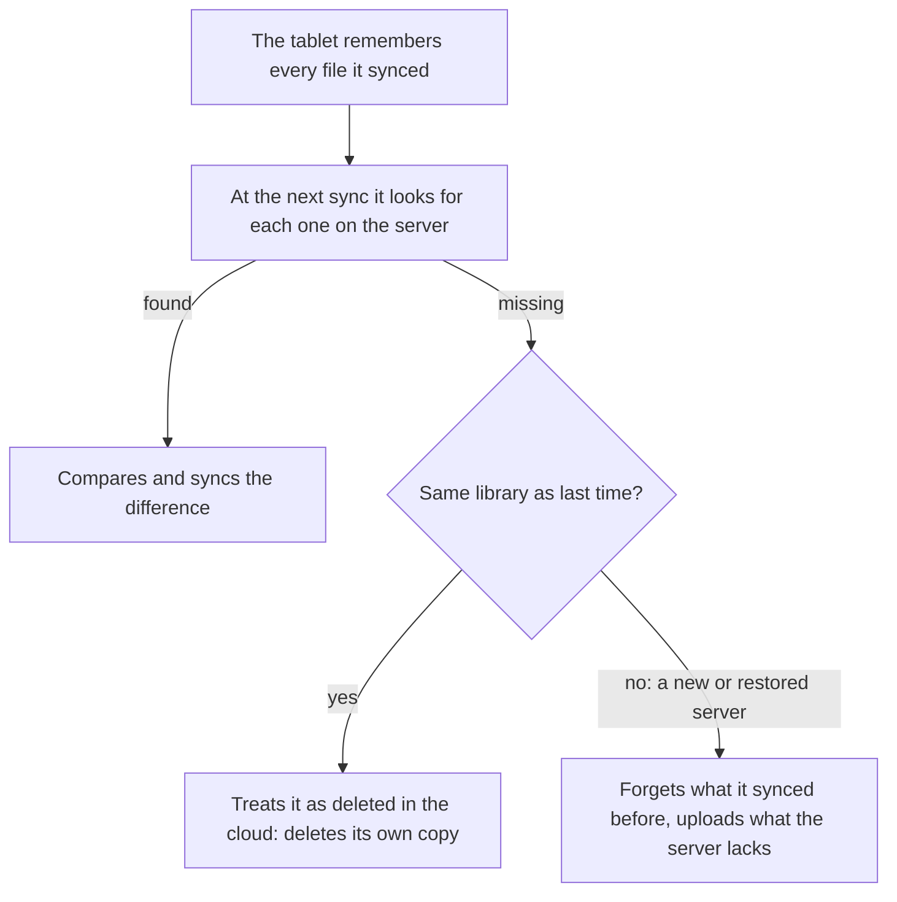

# How syncing works

The tablet syncs with Inkhold exactly as it would with Supernote's Private
Cloud: Inkhold speaks the same protocol, learnt by watching a real tablet. Two
ways start a sync.

- **By hand**, from the tablet's top bar: the tablet walks its folders,
  compares each file with the server's, and sends or fetches what differs.
- **Auto Sync**: the tablet keeps a connection open to Inkhold. It sends each
  change as you make it, and Inkhold tells it about changes made elsewhere,
  in the browser or on another tablet, within a second or two.

## Deleting syncs too

The tablet remembers every file it synced. When a file it remembers is gone
from the server, it takes that as "deleted in the cloud" and deletes its own
copy. So deleting in the browser deletes on the tablet at its next sync, and
deleting on the tablet moves the file into Inkhold's
[recycle bin](@/manual/deleted-file.md), where it can be brought back.

The diagram shows what the tablet does with a file it remembers syncing but
can't find on the server: deleted, unless the server turns out to be a
different library.

That rule is why a new or [restored](@/manual/restore.md) server is dangerous
to a tablet: every file missing from it would look deleted. Each Inkhold
library has its own identity, so a tablet that signs in to a different one
forgets what it synced before and starts from scratch, merging and uploading
instead of deleting. Copying the tablet first is still the safe way.

## Conflicts

When the same notebook changed on both sides, the tablet keeps both: it saves
one under a new name, ending in `_CONFLICT_` and a time, beside the other.
Nothing is overwritten.

## To-Do and Digest

The tablet's To-Do and Digest apps sync separately. To-Do sync works and is
[off until you turn it on](@/manual/todo-sync.md); Digest isn't implemented.
