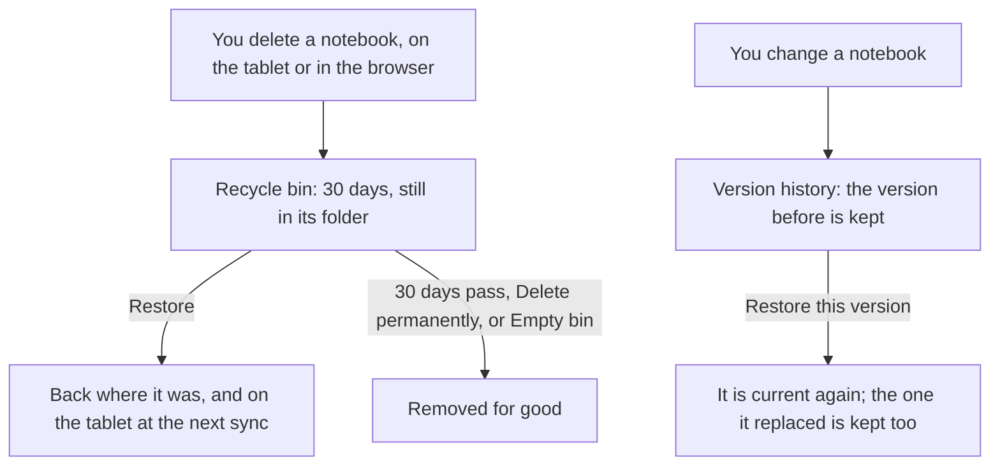

# Why nothing is deleted outright

A sync mistake, a tap in the wrong place, or a tablet that thinks a file was
deleted elsewhere: notebooks are easy to lose and slow to make again. So in
Inkhold a delete is a step towards removal, never the removal itself.

## Three layers of keeping

- **The recycle bin.** Whatever is deleted, on the tablet or in the browser,
  waits there for 30 days (the household can [change it](@/manual/quotas-and-bin.md))
  and goes back where it was when restored, on the tablet too.
- **Version history.** Each time a notebook changes, the version before is
  kept: 5 per file unless the household changes it. Restoring an old version
  keeps the one it replaces, so a restore can be undone too.
- **Backups.** Snapshots of everything, [on another disk](@/manual/back-up.md).

Where a file goes when it is deleted, and where a page goes when it is changed:

## When something is really removed

Only when a person or a rule says so, and always after a clear warning:

- **Delete permanently**, or **Empty bin**, in the recycle bin.
- The bin's window running out.
- History's limits: past its number of versions, or past the household's
  total for versions, the oldest versions of whoever is saving go first.
- An administrator deleting an account, after typing its address.

Kept versions and the bin count against their owner's allotment: keeping has a
cost, and it is shown.
