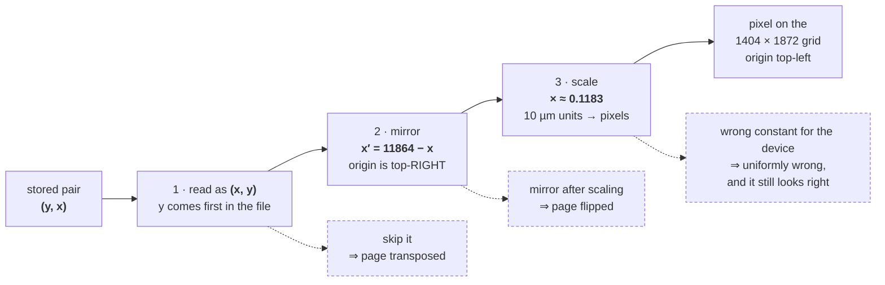

# Reference — the `.note` binary format

The Supernote `.note` container: block layout, metadata keys, bitmap encodings,
vector stroke data, recognition data, and the parts still uncharted.

Ratta publishes no specification. Everything on this page is reverse-engineered,
and every non-obvious claim carries an [evidence marker](#evidence-markers) that
says how far it can be trusted.

This page describes the *file format only*. It is meant to be sufficient to write
a parser in any language.

---

## Evidence markers

This is a reverse-engineered format. A claim that has been checked against a real
file and a claim that was copied from somebody else's notes are both written in
the same neutral voice, so the marker is the only thing distinguishing them.
Building on **I** or **?** as though it were **C** is how a decoder acquires a
silent bug.

| Marker | Meaning |
|---|---|
| **C** | **Confirmed.** Observed in a file we hold, *and* the interpretation checked — by decoding it and comparing the result against an independent implementation's output, or against the device's own rendering. |
| **I** | **Inherited.** Taken from a third-party reverse-engineering effort (see [Sources](#sources)) and never checked against a file we hold. Plausible, internally coherent, unconfirmed. |
| **?** | **Unverified.** Believed, guessed, or simply unknown. |

### What the corpus is

A **C** means "true of the files below", not "true of the format".

| Tier | Corpus |
|---|---|
| Container, metadata keys, recognition | **Two files**, both from one device class and one firmware: **Nomad (`APPLY_EQUIPMENT = N6`), firmware Chauvet 3.29.42, signature `SN_FILE_VER_20260016`**. |
| `RATTA_RLE` decoding and layer compositing | The two files above, plus **14 community sample files** distributed with [`snlib`](https://github.com/Walnut356/snlib) covering multi-layer pages, bitmap backgrounds, marker colours, erase/move, pressure, tilt and rotation. Decoding these reproduced `supernote-tool`'s output byte-for-byte. |

Landscape (`ORIENTATION = 1090`) storage was settled against a third Nomad
capture (`horizontal_layers.note`: 2 pages, both `1090`, 4 ink layers on
page 2) — see [§9.3](#93-orientation). A fourth capture (`one_thumb.note`:
2 pages, the user tapped "set as cover") settled the **cover** subtree
([§5](#5-keyword-title-link-and-cover-objects)). A fifth
(`layers_edited.note`: the user hid a layer, renamed another and reordered the
stack in the device's layer panel) settled `LAYERSEQ` semantics (hidden AND
deleted layers omitted; hidden bitmaps persist) and everything about
`LAYERINFO` — its two encodings, the `layerId` map and where display names
live ([§4.3](#43-page)).

Everything outside those tiers — the A-series family, the `N5`/Manta device
class, keyword/title/link blocks, `TOTALPATH`, `RECOGNFILE` — is **I**
or **?**. No file we hold exercises any of them.

---

## 1. Container primitives

**C**

A `.note` is an **address-based container**, not a linear stream. Nothing is
scanned; every structure is reached by absolute byte offset. Any single page or
layer can therefore be located and read without touching the rest of the file.

| Property | Value |
|---|---|
| Integer byte order | little-endian |
| Address size | 4 bytes (`u32`) |
| Length-prefix size | 4 bytes (`u32`) |
| Address `0` | means "absent" |
| Block shape | `[u32 length][length bytes of payload]` |
| Footer address | stored in the **last 4 bytes** of the file |

A block's **address** is the offset of its length prefix. Its payload begins four
bytes later.

Two block kinds share that shape:

- **Metadata block** — payload is ASCII `<KEY:VALUE>` pairs, concatenated with no
  separator, e.g. `<PAGE1:138538><FILE_FEATURE:9179>`. Footer, header, page,
  layer, keyword, title and link blocks are all metadata blocks.
- **Content block** — payload is raw bytes: a `RATTA_RLE` stream, base64 JSON, a
  ZIP, an image.

### 1.1 How the pieces nest


Every arrow is a `u32` address read out of a `<KEY:VALUE>` pair. Double-bordered
nodes are content blocks (raw bytes); the rest are metadata blocks.

### 1.2 Metadata pair grammar

**C**

- A pair is `<`, a key, `:`, a value, `>`.
- The value runs from the first `:` to the next `>`. It may contain `:`, `,`,
  `#`, quotes — anything but `>`. `LAYERINFO` exploits this by writing JSON with
  `#` where a `:` would go (its newer base64 encoding sidesteps the grammar
  entirely — see [§4.3](#43-page)).
- **Keys may repeat.** Entries form an ordered list, not a map. `PAGE`,
  `KEYWORD_*` and `LINK*` all recur. A parser that builds a map loses data.
- Values are untyped text. `APPLY_EQUIPMENT:N6` is a string, not a number; a
  value that looks numeric is not guaranteed to be one.
- Order is significant for `PAGE*` keys: footer order is page order.

!!! note "Two grammars are in circulation"
    `supernote-tool` parses pairs with the regex `<([^:<>]+):(.*?)>`, which
    forbids both `>` **and** `<` inside a key. A looser grammar rejecting only
    `<` also parses every file observed. No known file distinguishes the two, so
    either is safe today.

---

## 2. Signatures and file families

**C** for the X-series detection rule and the `SN_FILE_VER_20260016` entry;
**I** for the rest of the table.

The first 4 bytes are a file-type marker (the ASCII bytes `note` in every file
observed). A signature string then identifies the format family and version.

| Family | Signature offset | Signature pattern | Bitmaps | Layers |
|---|---|---|---|---|
| X-series (A5X, A6X, A5X2, Manta, Nomad …) | 4 | `SN_FILE_VER_` + 8 digits | `RATTA_RLE` | yes, up to 5 |
| Original (A-series) | 0 | `SN_FILE_ASA_` + 8 digits | `SN_ASA_COMPRESS` (zlib) | no |

Detection order is X-series first, original second. The X-series is the
mainstream format; the original family predates it and appears not to be
produced by current firmware.

The trailing 8 digits are a **monotonic version key** and are usable as an
ordered integer.

| Predicate | Rule | Marker |
|---|---|---|
| High-resolution grayscale supported | `version >= 20230015` | **I** for the exact threshold; **C** that `20260016` carries high-resolution (X2) data |

Known X-series signatures and their firmware, newest last. All **I** except
`20260016`, which is **C**:

| Signature | Firmware | | Signature | Firmware |
|---|---|---|---|---|
| `SN_FILE_VER_20200001` | C.053 | | `SN_FILE_VER_20210010` | Chauvet 2.1.6 |
| `SN_FILE_VER_20200005` | C.077 | | `SN_FILE_VER_20220011` | Chauvet 2.5.17 |
| `SN_FILE_VER_20200006` | C.130 | | `SN_FILE_VER_20220013` | Chauvet 2.6.19 |
| `SN_FILE_VER_20200007` | C.159 | | `SN_FILE_VER_20230014` | Chauvet 2.10.25 |
| `SN_FILE_VER_20200008` | C.237 | | `SN_FILE_VER_20230015` | Chauvet 3.14.27 |
| `SN_FILE_VER_20210009` | C.291 | | `SN_FILE_VER_20260016` | Chauvet 3.29.42 |

Only `SN_FILE_ASA_20190529` is known for the original family (**I**).

An unknown but pattern-matching signature is safely treated as "latest": no
observed version has removed a field.

---

## 3. Resolution order

**C**

```
1.  footer_address = u32le(file_size - 4)
2.  footer  = metadata_block(footer_address)
3.  header  = metadata_block(int(footer["FILE_FEATURE"]))
4.  for each footer key starting with "PAGE", in footer order:
5.      page = metadata_block(int(value))
6.      for slot in [MAINLAYER, LAYER1, LAYER2, LAYER3, BGLAYER]:
7.          addr = int(page[slot]) or 0;  skip when 0
8.          layer = metadata_block(addr)
9.  resolve cover / keyword / title / link blocks from the footer (§5)
```

Properties of this path:

- Every step is a small absolutely-addressed read. Peak memory is the parsed
  metadata plus the single largest metadata block — **never the file size**.
  Bitmap and recognition content blocks can be read lazily afterwards, by
  address.
- Page selection is a prefix match on **footer** keys: `PAGE`, `PAGE1`, `PAGE2` …
  all match, in file order. A parser matching only `PAGE\d+` would miss a
  single-page file's bare `PAGE`.
- Layers are collected in the fixed slot order above, **not** in `LAYERSEQ`
  order. `LAYERSEQ` affects drawing only ([§8](#8-compositing)).
- Every offset in the file was written by a device. A parser reading untrusted
  files must bounds-check each address and length against the file size, with
  overflow-checked arithmetic: a hostile or corrupt length is otherwise an
  out-of-bounds read.

---

## 4. Metadata keys

### 4.1 Footer

| Key | Meaning | Marker |
|---|---|---|
| `FILE_FEATURE` | address of the header block. Required; a file without it cannot be resolved. | **C** |
| `PAGE`, `PAGE1`, `PAGE2`, … | address of each page block; footer order is page order | **C** |
| `COVER_1`, `COVER_2`, `COVER_3` | cover image content address. The suffix is a TYPE, not a page number: `COVER_3` and `COVER_2` are both user-set (`COVER_3` is the newer key current firmware writes for a user-set cover), `COVER_1` ≈ automatic. Preference is **newest-wins** — `COVER_3` → `COVER_2` → `COVER_1` — extending the reference's `COVER_2`-over-`COVER_1` order (supernote-tool `parser.py:181-184`, whose `manipulator.py` writes `COVER_2` for an injected custom cover) to the later key. | **C** for `COVER_3` (`user_cover.note`: `<COVER_3:429>` written by "set as cover" on current firmware) and `COVER_2` (`one_thumb.note`); **I** for `COVER_1` — no capture carries one |
| `COVER_0` | the "no cover set" placeholder: the device writes an explicit `<COVER_0:0>` while no cover is chosen, and REPLACES it with a `COVER_2`/`COVER_3` address when one is set. Absent on older files. All no-cover shapes mean the same thing. | **C** — scan of 9 live notes: seven `<COVER_0:0>`, one real `COVER_2`, one (older) file with no COVER key at all |
| `KEYWORD_*` | keyword metadata block addresses ([§5](#5-keyword-title-link-and-cover-objects)) | **I** |
| `TITLE_*` | title metadata block addresses. The digits encode a page number: `int(key[6:10]) - 1`. | **I** |
| `LINK*` | link metadata block addresses; page number encoded the same way | **I** |

### 4.2 Header

| Key | Meaning | Marker |
|---|---|---|
| `APPLY_EQUIPMENT` | device class code; determines page dimensions and the millimetre scale ([§9](#9-hardware-bound-constants)) | **C** for `N6`; **I** for `N5` |
| `FILE_ID` | notebook id | **C** |
| `FILE_RECOGN_TYPE` | `"1"` ⇒ realtime handwriting recognition enabled for this file | **C** that the key exists; **I** for the value's meaning |
| `FILE_RECOGN_LANGUAGE` | recognition language tag, e.g. `pt_BR` | **C** that the key exists and carries a POSIX-style locale tag; **I** for the full value space |

### 4.3 Page

| Key | Meaning | Marker |
|---|---|---|
| `MAINLAYER`, `LAYER1`, `LAYER2`, `LAYER3`, `BGLAYER` | address of each layer's metadata block. `0` or absent ⇒ that slot is unused. `BGLAYER` is the background/template layer. | **C** |
| `LAYERSEQ` | comma-separated layer keys, **top-to-bottom** draw order — the authoritative draw list. It is `LAYERINFO`'s stack order **filtered to drawn layers**: both HIDDEN (`isVisible:false`) and DELETED (`isDeleted:true`) layers are omitted from the sequence. A hidden layer's bitmap block PERSISTS in the file — only the draw list drops it — where a deleted layer's slot key is absent entirely. | **C** — the device DOES write non-default sequences: `horizontal_layers.note` / `layers_edited.note` page 2 carry `LAYERSEQ:LAYER3,LAYER1,MAINLAYER,BGLAYER` while `LAYERINFO` places the HIDDEN `LAYER2` between `LAYER1` and `MAINLAYER` (`isVisible:false, isDeleted:false`) and its bitmap decodes fine. A device reorder rewrites both keys consistently. The golden composite hashes in `tests/content_test.zig` pin the omission behaviour. (An earlier revision of this row read page 2's omission as *deletion* — that came from a STALE page-block generation the append-only container still holds; only footer-referenced blocks are current.) |
| `PAGESTYLE` | template/background style name, e.g. `style_white`, `style_5mm_dots` | **C** |
| `PAGESTYLEMD5` | hash of the style asset; `"0"` = none | **I** |
| `ORIENTATION` | `"1000"` vertical, `"1090"` horizontal (per page; a `1090` page's raster is stored natively landscape) | **C** — both values observed; see [§9.3](#93-orientation) |
| `PAGEID` | page id | **I** |
| `RECOGNSTATUS` | `0` none, `1` finished, `2` running | **C** — all three values observed |
| `RECOGNTEXT` | address of the base64-JSON transcript content block; `0`/absent when unfinished | **C** — [§11](#11-handwriting-recognition) |
| `RECOGNFILE` | address of a MyScript iink package | **I** — [§11.2](#112-recognfile) |
| `TOTALPATH` | address of the page's vector stroke data | **C** that the key exists and holds a non-zero address on a page with ink; **I** for the block's contents — [§10](#10-totalpath-vector-strokes) |
| `LAYERINFO` | the layer panel's state: a JSON array covering the **full stack in top-to-bottom order, hidden and deleted entries included** (`LAYERSEQ` is this order filtered to drawn layers). Fields per entry: `layerId`, `name`, `isBackgroundLayer`, `isAllowAdd`, `isCurrentLayer`, `isVisible`, `isDeleted`, `isAllowUp`, `isAllowDown`. See the note below for the TWO encodings, the `layerId` map and the name semantics. | **C** — both encodings, the id map, hidden-vs-deleted and the rename/reorder behaviour are all pinned by `layers_edited.note` (a deliberate on-device panel-edit capture) and parsed by `src/layerinfo.zig` |
| `PROTOCOL` | bitmap encoding name for **non-layered** pages | **I** |
| `DATA` | bitmap content address for **non-layered** pages | **I** |
| `PAGENO` | page number | **?** |
| `LAYERPATH`, `LAYERVECTORGRAPH`, `LAYERRECOGN` | observed alongside `LAYERBITMAP` in a third-party structural spec | **?** — meaning unconfirmed |

!!! note "`LAYERINFO`: two encodings, the id map, and where names live"
    **All C** — established from `layers_edited.note` (`4239d7c9…`), a capture
    made by hiding Layer 2, renaming the top layer and reordering the stack in
    the device's layer panel, then syncing.

    **Two encodings, mixed per page within one file.** Detect by the value's
    FIRST BYTE:

    - `[` or `{` → **`#`-JSON** (legacy): literal JSON with `#` standing in
      wherever JSON syntax expects `:` (the `:` would not survive the device's
      own `<KEY:VALUE>` parsing). The substitution is structural: undo it only
      OUTSIDE JSON strings (tracking quote/escape state), or a name containing
      a literal `#` is corrupted by a global replace.
    - anything else → **base64 of plain, ordinary JSON**. An on-device layer-
      panel edit REWRITES that page's `LAYERINFO` in this form; untouched pages
      keep `#`-JSON, so `layers_edited.note` carries `#`-JSON on page 1 and
      base64 on page 2 simultaneously. (supernote-tool v0.7.1 *does* decode the
      base64 form — `converter.py:190-193`, as a fallback — but then still runs
      its global `#`→`:` replace over the decoded JSON, so a name containing a
      literal `#` is corrupted; our tokenizer-level fixup is the difference,
      not the base64 awareness. Corrected 2026-07-24 from an earlier claim that
      it did not know the form at all.)

    **`layerId` ↔ slot:** `0` = `MAINLAYER`, `1`–`3` = `LAYER1`–`LAYER3`,
    **`-1` = `BGLAYER`** (the same entry says `isBackgroundLayer:true`, name
    "Background Layer").

    **Display names live ONLY here.** `name` is the user-visible, renamable
    label ("Layer Renamed"); the layer block's `LAYERNAME` stays the slot
    constant (`LAYER3`) through a rename. Never show `LAYERNAME`.

    **Hidden ≠ deleted.** `isVisible:false, isDeleted:false` = hidden: omitted
    from `LAYERSEQ` (so not drawn) but the bitmap block persists and decodes.
    `isDeleted:true` = deleted: no layer block at all. Slots that were never
    created also read `isDeleted:true` — "deleted" covers "not present".

    **Order.** The array is the full stack top-to-bottom; a reorder in the
    panel rewrites `LAYERINFO` and `LAYERSEQ` consistently, `LAYERSEQ` being
    the drawn-layer filter of this order.

!!! note "Non-layered pages"
    A page may carry `PROTOCOL` + `DATA` — a single bitmap, no layer slots —
    instead of the five layer keys. A parser that only looks for layer slots will
    resolve such a page to **zero layers** and produce a blank result rather than
    an error. No file we hold uses this form; it is **I**, from
    `supernote-tool`.

### 4.4 Layer

| Key | Meaning | Marker |
|---|---|---|
| `LAYERBITMAP` | address of the layer's bitmap content block; `0` ⇒ no content | **C** |
| `LAYERNAME` | the SLOT CONSTANT (`MAINLAYER`, `LAYER3`, …) — **not** a display name. It does not change when the user renames the layer; the user-visible name lives only in the page's `LAYERINFO`. | **C** — `layers_edited.note` page 2: `LAYERNAME:LAYER3` beside `LAYERINFO` name "Layer Renamed" |
| `LAYERPROTOCOL` | encoding name, e.g. `RATTA_RLE` | **C** that the key exists and reads `RATTA_RLE`; see the warning |
| `LAYERTYPE` | layer type, e.g. `NOTE` | **I** |

For a layered page, `supernote-tool` takes the page's effective `PROTOCOL` from
`MAINLAYER`'s `LAYERPROTOCOL` (**I**).

!!! danger "`LAYERPROTOCOL` does not reliably name the encoding"
    Files observed declaring `LAYERPROTOCOL: RATTA_RLE` carry **X2-variant**
    data, which uses a different colour table ([§7.2](#72-the-x2-variant)).
    Decoding such a layer with the base `RATTA_RLE` table succeeds — the stream
    is structurally valid either way — and silently produces wrong greys.

    **The file signature is the reliable discriminator**: `version >= 20230015`
    selects the X2 colour table. Treat `LAYERPROTOCOL` as informational until a
    file proves otherwise.

---

## 5. Keyword, title, link and cover objects

Keyword/title/link: **I**, entirely — described by `supernote-tool`; no file we
hold has been examined for them, and their content-block encodings (PNG vs RLE,
and whether that varies by version) are unknown. The **cover** is now **C**
(2026-07-23, two captures — see below).

**Cover** — a content block at `COVER_3`, falling back to `COVER_2`, then
`COVER_1` (newest user-set key wins). **C**: verified against `one_thumb.note`
(Nomad, Chauvet 3.29.42): `<COVER_2:429>` resolves to a **complete pre-rendered
PNG at full device resolution** (1404×1872, ~37 KB), background template and ink
already composited by the firmware — extracting it is a block copy, no
rendering. Covers are **NOT auto-generated**: the key appears when the user sets
a cover; current firmware writes `COVER_3` for this (the real `user_cover.note`
incident — a 6.5 MB PNG at `<COVER_3:429>` — is what added the key here), older
firmware wrote `COVER_2`. Until a cover is set the footer carries the explicit
`<COVER_0:0>` placeholder (`horizontal_layers.note` and six other live notes),
or — on older files — no COVER key at all (`sample.note`). The per-page
`THUMBNAILTYPE:0` is unrelated/vestigial: it stays `0` with a cover present.
`COVER_1` (≈ automatic) remains **I** — no capture carries one; the preference
order is pinned synthetically in `tests/note_test.zig`. Note a cover block is
NOT the ~37 KB the first capture suggested — `COVER_3` covers run to several MB,
which is why the indexer records the block's *address + length* and the serve
path STREAMS it straight from the immutable blob rather than buffering it.

**Keyword block** (address from a `KEYWORD_*` footer key):

| Key | Meaning |
|---|---|
| `KEYWORD` | the keyword text — but the authoritative copy is re-read from the `KEYWORDSITE` content block |
| `KEYWORDPAGE` | page number, **1-based** |
| `KEYWORDRECT` | `left,top,width,height` |
| `KEYWORDRECTORI` | `left,top,width,height`, original orientation |
| `KEYWORDSITE` | content block address |

**Title block** (address from a `TITLE_*` footer key; the page number comes from
the *key*, as `int(key[6:10]) - 1`):

| Key | Meaning |
|---|---|
| `TITLEBITMAP` | content address of the title strip image |
| `TITLERECTORI` | `left,top,width,height` |

**Link block** (address from a `LINK*` footer key; page number encoded as for
titles):

| Key | Meaning |
|---|---|
| `LINKBITMAP` | content block address |
| `LINKRECT` | `left,top,width,height` |
| `LINKTYPE` | `0` = page, `1` = file, `4` = web |
| `LINKINOUT` | `0` = outbound, `1` = inbound |
| `LINKFILE` | Base64-encoded path or URL |
| `LINKFILEID`, `PAGEID` | target ids; the literal string `"none"` means null |
| `LINKTIMESTAMP` | timestamp |

---

## 6. Layout of a minimal container

A synthetic, hand-authored example: one page, one main layer, a two-byte bitmap.
Offsets are decimal. Total file size 232 bytes.

| Offset | Size | Bytes / payload | Role |
|---|---|---|---|
| 0 | 4 | `note` | file-type marker |
| 4 | 20 | `SN_FILE_VER_20260016` | signature |
| 24 | 4 | `02 00 00 00` | bitmap block length |
| 28 | 2 | `61 00` | `RATTA_RLE`: colour `0x61` (black), run of 1 |
| 30 | 4 | `4E 00 00 00` | layer block length (78) |
| 34 | 78 | `<LAYERNAME:MAINLAYER><LAYERPROTOCOL:RATTA_RLE><LAYERTYPE:NOTE><LAYERBITMAP:24>` | layer metadata |
| 112 | 4 | `37 00 00 00` | page block length (55) |
| 116 | 55 | `<PAGESTYLE:style_white><ORIENTATION:1000><MAINLAYER:30>` | page metadata |
| 171 | 4 | `14 00 00 00` | header block length (20) |
| 175 | 20 | `<APPLY_EQUIPMENT:N6>` | header metadata |
| 195 | 4 | `1D 00 00 00` | footer block length (29) |
| 199 | 29 | `<FILE_FEATURE:171><PAGE1:112>` | footer index |
| 228 | 4 | `C3 00 00 00` | footer address (195) |

Note that every address in the file (`LAYERBITMAP:24`, `MAINLAYER:30`,
`FILE_FEATURE:171`, `PAGE1:112`, and the trailing `195`) points at a **length
prefix**, not at a payload. Writers therefore emit content before the blocks that
reference it, innermost first — which is why the footer is last and the bitmap
first.

---

## 7. Bitmap encodings

Four encodings are named in the reverse-engineering record.

| Encoding | Family | Marker |
|---|---|---|
| `RATTA_RLE` | X-series | **C** |
| `RATTA_RLE` X2 variant | X-series, `version >= 20230015` | **C** |
| `SN_ASA_COMPRESS` | original A-series | **I** |
| `PNG` | some content blocks | **I** |

### 7.1 `RATTA_RLE`

**C**

The stream is a sequence of `(colour_code, length_byte)` **pairs** producing a
row-major bitmap of exactly `width * height * (bits_per_pixel / 8)` bytes. In
every observed file that is 8-bit grayscale, so exactly `width * height` bytes.

| Length byte | Run length |
|---|---|
| `0xFF` | `0x4000` — or `0x400` when the layer carries the [all-blank shortcut](#the-all-blank-shortcut) |
| bit 7 set (`& 0x80`) | **held**: the high part of a two-byte length, resolved against the next pair |
| otherwise | `length_byte + 1` |

Resolving a held pair `(c_h, l_h)` against the next pair `(c, l)`:

- **Same colour** (`c == c_h`) → a single run of
  `1 + l + (((l_h & 0x7F) + 1) << 7)`.
- **Different colour** → emit the held run as `((l_h & 0x7F) + 1) << 7`, then
  process `(c, l)` normally.
- **End of stream with a pair still held** → emit
  `((l_h & 0x7F) + 1) << i` for the largest `i` in 7…0 whose result fits the
  remaining gap; if none fits, emit nothing. This exists so a held tail can be
  adjusted to land exactly on the expected buffer size.

A lone trailing byte (an odd-length stream) is ignored.

**The decoded length must equal the expected size exactly.** There is no
in-stream terminator and no per-row framing, so a wrong `width` does not fail —
it shears the image diagonally. Length equality is the only integrity check the
encoding offers, and it must be enforced.

#### The all-blank shortcut

The all-blank flag is **not in the stream**. It is inferred from the container,
and it changes the meaning of the `0xFF` length byte from `0x4000` to `0x400`:

```
all_blank = slot == BGLAYER
         && PAGESTYLE == "style_white"
         && content_block_length == 0x140E
```

The `0x140E` (5134) constant is **I** and unexplained — an exact block size
matched as a magic number, with no structural cross-check against the stream
itself.

#### Colour codes

Any code **not** in the table below passes through **literally as the grayscale
value**. That is how the X2 variant stores anti-aliasing greys, and it means an
unknown code can never fail a decode — only look wrong.

| Code | `RATTA_RLE` → gray | X2 variant → gray | Name |
|---|---|---|---|
| `0x61` | `0x00` | `0x00` | black |
| `0x62` | `0xFF` | `0xFF` | background / transparent |
| `0x63` | `0x9D` | `0x30` | dark grey (X2: *compat* dark grey) |
| `0x64` | `0xC9` | `0x50` | grey (X2: *compat* grey) |
| `0x65` | `0xFE` | `0xFE` | white |
| `0x66` | `0x00` | `0x00` | marker black |
| `0x67` | `0x9D` | literal | marker dark grey |
| `0x68` | `0xC9` | literal | marker grey |
| `0x9D` | literal | `0x9D` | dark grey (X2) |
| `0x9E` | literal | `0x9D` | marker dark grey (X2) |
| `0xC9` | literal | `0xC9` | grey (X2) |
| `0xCA` | literal | `0xC9` | marker grey (X2) |
| any other | literal | literal | anti-aliasing grey |

!!! note "`0xFE` white is not `0xFF` white"
    Colour code `0x65` decodes to `0xFE`, one below `0xFF`. `0xFF` is
    simultaneously the **transparent** sentinel and the value a compositing
    canvas starts at ([§8](#8-compositing)). A layer can therefore paint an
    opaque near-white (`0xFE`) that **masks** the layer below — which `0xFF`
    would not. The one-step difference is load-bearing, not a rounding artefact.

### 7.2 The X2 variant

**C**

Same algorithm, same length rules, **different colour table** — the third column
of the table above. It exists to carry high-resolution grayscale: dark grey and
grey move to `0x9D`/`0xC9`, the old `0x63`/`0x64` codes are retained as
*compatibility* entries mapping to darker values, and every unlisted byte is a
literal grey level.

Selection is by **file signature** (`version >= 20230015`), not by
`LAYERPROTOCOL` — see the warning in [§4.4](#44-layer).

### 7.3 Colour palette

**C** for the grayscale column; **I** for the RGB column.

| Name | Gray | RGB |
|---|---|---|
| black | `0x00` | `#000000` |
| dark grey | `0x9D` | `#9d9d9d` |
| grey | `0xC9` | `#c9c9c9` |
| white | `0xFE` | `#fefefe` |
| transparent | `0xFF` | `#ffffff` |
| compat dark grey | `0x30` | `#303030` |
| compat grey | `0x50` | `#505050` |

Grayscale layers are 8 bits per pixel. `supernote-tool` also models 24-bit RGB
layers (and 32-bit with alpha on the A-series path), but **?** — no observed
layer is anything other than 8-bit grayscale.

### 7.4 `SN_ASA_COMPRESS` (original A-series)

**I**, entirely. The content block is zlib-compressed. Decompressing yields an
array of `u16` colour codes at an internal size of **1404 × 1888**; rotate 90°
clockwise and drop the bottom 16 rows to reach 1404 × 1872.

| Code | Colour |
|---|---|
| `0x0000` | black |
| `0xFFFF` | background |
| `0x2104` | dark grey |
| `0xE1E2` | grey |

No A-series file has ever been examined.

### 7.5 `PNG`

**I** — some content blocks are said to be plain PNG, decoded directly, with the
result required to match the page dimensions. No observed layer uses it.

---

## 8. Compositing

**C**

1. Clear the canvas to `0xFF`.
2. Determine **bottom-to-top** order: reverse `LAYERSEQ`, skipping tokens that
   are not one of the five slot keys. When `LAYERSEQ` is absent or yields no
   valid token, fall back to `BGLAYER, MAINLAYER, LAYER1, LAYER2, LAYER3`.
3. For each layer in that order with a non-zero `LAYERBITMAP`: decode it to a
   full-page grayscale buffer, then copy every pixel whose value is **not**
   `0xFF` over the canvas.

Transparency is a **single sentinel value**, not an alpha channel. There is no
blending: a pixel is either `0xFF` (leave what is underneath) or an opaque grey.
Layer order is the only thing that resolves overlap, which is why `LAYERSEQ`
must be honoured and why `0xFE` white is distinct from `0xFF`.

---

## 9. Hardware-bound constants

**These describe a hardware class, not the format.** Getting them wrong produces
mirrored or mis-scaled output that still *looks* plausible.

### 9.1 Page dimensions, in pixels

| `APPLY_EQUIPMENT` | Device | Pixels | Marker |
|---|---|---|---|
| `N5` | A5X2 / Manta | 1920 × 2560 | **I** |
| `N6` | Nomad | 1404 × 1872 | **C** |
| anything else, or absent | A5X, A6X, … | 1404 × 1872 (default) | **I** for the device list; **C** that the default applies to `N6`, which is not special-cased by `supernote-tool` |

Only `N5` is special-cased. Everything else, `N6` included, falls to the
1404 × 1872 default — which is correct for the Nomad.

A wrong pixel size is **self-announcing**: `RATTA_RLE` carries no row framing, so
a wrong width shears the image, and a wrong total size fails the decoder's
length-equality check ([§7.1](#71-ratta_rle)). Cross-checking the decoded byte
count against `width * height` catches it.

### 9.2 Physical canvas, in millimetres

**C** for `N6` only.

| `APPLY_EQUIPMENT` | Canvas | Scale at 1404 px wide |
|---|---|---|
| `N6` | 118.64 × 158.19 mm | ≈ 11.834 px/mm, isotropic |
| anything else | **unknown** | **?** |

!!! danger "This is an allowlist and must not have a fallback"
    Unlike pixel dimensions, a wrong millimetre scale is **silent**. Its consumer
    is coordinate data — recognition bounding boxes ([§11.1](#111-recogntext))
    and vector strokes ([§10.1](#101-coordinate-transform)) — which is often
    invisible or only loosely checkable against the raster.

    An N5/Manta is 1920 × 2560 — the **same aspect ratio** — so it would fall
    through a pixel-style default happily while its true scale is plausibly ~10 %
    away. Everything would look right and be wrong.

    Establishing a value for a new device requires a real file from that device
    whose coordinate data has been checked against its own render. It cannot be
    inferred from the pixel table.

### 9.3 Orientation

**C** — both values observed, and the storage question settled.

`ORIENTATION` is **per-page** and encodes the rotation as `1000 + degrees`:
`"1000"` = 0°, `"1090"` = 90°, `"1180"` = 180°, `"1270"` = 270°. What matters for
the raster is the ROW WIDTH, and a **90° _or_ 270°** rotation is what stores it
natively landscape — so **both `"1090"` and `"1270"` are horizontal**; `"1000"`
and `"1180"` (portrait-shaped, 180° merely upside-down) are vertical, as is any
unrecognized value or an absent key. There is no file-level orientation; the
header's `HORIZONTAL_CHECK` key does not carry one (a dead key — ignore it).

> Originally read as "only `1090` is horizontal" (mirroring an older
> `supernote-tool`). A real Nomad note carrying `ORIENTATION:1270`
> (`Ozymandias - Percy Shelley.note`) decoded at portrait width and sheared until
> `1270` was added — see `types.Orientation.fromValue`.

**A landscape page's raster is stored natively landscape.** The bitmap is the
same flat `RATTA_RLE` stream as always, but its true row width is the *swapped*
base width: a Nomad `1090` page decodes as 1872-wide × 1404 rows (an N5 page
would be 2560-wide). Nothing is rotated after decode — the stream itself is
landscape, template (`BGLAYER`) content included.

Evidence, from both directions:

- **Empirical** — a real Nomad capture (`horizontal_layers.note`: 2 pages, both
  `1090`, 4 ink layers on page 2) decodes coherently at 1872-wide rows.
  `RATTA_RLE` has no row framing, so a wrong width cannot hide: at 1404 the
  same stream shears ([§9.1](#91-page-dimensions-in-pixels)).
- **Reference agreement** — `supernote-tool` v0.7.1 swaps width and height
  *before* decoding (`decoder.py:138-139`) and its converters render natively
  landscape, never rotating. There is no `style_h_*` special-casing: landscape
  templates are landscape-stored too.

One latent reference bug is deliberately **not** replicated here: its
`PngDecoder` ignores the swapped dimensions (it trusts the PNG's own header),
so a PNG layer on a landscape page would come out unswapped. This codebase
labels every layer of a `1090` page with the effective (swapped) dims.

In this codebase the swap fact lives in exactly one place —
`types.Dimensions.oriented` — consumed by `render.zig`, `page_payload.zig` and
the server's `note_index`, so no consumer can hold a differing opinion of it.

---

## 10. `TOTALPATH` vector strokes

**C** that `TOTALPATH` exists on a page and holds a non-zero address.

**I / ?** for everything below, from Walnut356's
[blog post](https://walnut356.github.io/posts/inspecting-the-supernote-note-format/)
and [`snlib`](https://github.com/Walnut356/snlib). Never checked against a file
we hold. Some `unk` configuration fields are unexplained even in that source.

`TOTALPATH` addresses the **vector stroke data for a whole page** — the strokes
as drawn, before they were flattened into `LAYERBITMAP`. It is a length-prefixed
section of consecutive strokes.

Each stroke, in order:

| Part | Contents |
|---|---|
| **Head** | `section_len` (u32), `pen` (enum), `stroke_color` (enum), `thickness` (Size enum, roughly 200…3800 in canvas units), several `unk`/config u32s, `page_num`, `stroke_layer` |
| **Text buffers** | a 52-byte buffer holding the stroke kind — the string `"straightLine"` or `"others"` — followed by a 52-byte buffer holding `"superNoteNote"` |
| **Geometry** | a bounding box (min, max and midpoint), then parallel **length-prefixed arrays**, one entry per point |
| **Tail** | a stroke UID, then screen-space `f32` point contours |

The parallel arrays:

| Array | Element | Range / notes |
|---|---|---|
| points | `{ i32 x, i32 y }` | canvas units — but see [§10.1](#101-coordinate-transform) for the axis order |
| pressure | `u32` | 0 – 4096 |
| tilt | two `i16` | angle recovered via `atan2` |
| flags | `u8` | meaning unknown (**?**) |

| `pen` | Value |
|---|---|
| InkPen | 1 |
| NeedlePoint | 10 |
| Marker | 11 |

| `stroke_color` | Value |
|---|---|
| Black | 0 |
| MarkerBlack | 1 |
| DarkGrey | 158 |
| LightGrey | 202 |
| White | 254 |
| Eraser | 255 |

**An eraser is a stroke.** Colour 255 marks a stroke used as a mask over the
strokes beneath it, rather than an edit applied to them. A stroke that ends up
fully masked is deleted from the data outright.

This means `TOTALPATH` retains information the raster has destroyed: the strokes
an eraser passed over are still present, along with per-point pressure and tilt
that the flattened bitmap never recorded.

### 10.1 Coordinate transform

Three independent chances to be wrong, and the order matters. All **I**.



Dashed boxes are the failure each step invites.

1. **Axis order.** Coordinates are stored **`(y, x)`**, not `(x, y)`.
2. **Origin.** The origin is **top-right**, so `screen_x = 11864 - x` — applied
   **before** any scaling, because `11864` is expressed in canvas units.
3. **Scale.** Canvas space is `11864 × 15819` in **10 µm units**
   (= 118.64 × 158.19 mm). The factor ≈ `0.1183` maps canvas units onto the
   1404 × 1872 pixel grid.

!!! warning "`11864 × 15819` is a hardware constant, not a format constant"
    It is the same physical canvas as [§9.2](#92-physical-canvas-in-millimetres),
    expressed in 10 µm units, and it describes the **1404 × 1872 X-series /
    Nomad class only**. An N5/Manta shares the aspect ratio at a different pixel
    count, so a hard-coded `11864` yields a plausible-looking, uniformly wrong
    scale — and a wrong *origin* constant mirrors the page horizontally.

    Derive the scale from the page's own pixel dimensions where possible, and
    take the canvas extent from a per-equipment allowlist with no fallback, the
    same rule [§9.2](#92-physical-canvas-in-millimetres) states.

---

## 11. Handwriting recognition

Recognition is performed **on the device**, is **per page**, and is
**status-gated** by `RECOGNSTATUS`. A file records only what the device has
already recognised; nothing in the format implies text can be derived from an
unrecognised page.

| `RECOGNSTATUS` | Meaning | `RECOGNTEXT` | `RECOGNFILE` | Marker |
|---|---|---|---|---|
| `0`, or key absent | never recognised | absent / address `0` | absent | **C** |
| `1` | finished | populated | present | **C** |
| `2` | running | present but **empty** | present | **C** |

File-level flags in the header: `FILE_RECOGN_TYPE = "1"` means recognition is
enabled, and `FILE_RECOGN_LANGUAGE` carries the language tag. Neither implies any
particular page has finished.

### 11.1 `RECOGNTEXT`

**C**

The content block is **base64** (standard alphabet) wrapping a JSON document:

```json
{ "elements": [
  { "label": "Test", "type": "Text",
    "words": [
      { "label": "Test",
        "bounding-box": { "x": 3.31, "y": 11.76, "width": 30.31, "height": 16.53 } },
      { "label": "\n", "bounding-box": null }
    ] },
  { "type": "Raw Content" } ] }
```

| Field | Type | Notes |
|---|---|---|
| `elements[].type` | string | `"Text"` and `"Raw Content"` observed. Only `"Text"` carries usable words. |
| `elements[].label` | string | the element's joined transcript |
| `elements[].words[].label` | string | one word, **or** a layout separator: `"\n"` or `" "` |
| `elements[].words[].bounding-box` | object **or `null`** | **millimetres**, origin **top-left** |

Two properties that a parser must handle explicitly:

- **`bounding-box` is nullable, and null is common.** The device emits layout
  separators as words with no position. They must be *skipped*, not defaulted to
  `{0,0,0,0}` — which would pile every separator into the top-left corner. A
  schema that types the field as non-optional fails the whole document on the
  first null, costing the page its entire transcript.
- **The boxes are in millimetres, not pixels.** On a 1404 × 1872 page, reading
  them as pixels places every word inside the top-left ~112 × 149 px corner —
  wrong in a way that is easy to mistake for a layout bug. Converting requires
  the millimetre canvas of [§9.2](#92-physical-canvas-in-millimetres), which is
  known only for verified hardware.

### 11.2 `RECOGNFILE`

**I**, entirely. A **MyScript iink package**: a ZIP (magic `PK…`) containing

```
meta.json
rel.json
index.bdom
pages/<id>/ink.bink
pages/<id>/page.bdom
pages/<id>/style.css
pages/<id>/meta.json
```

Richer than `RECOGNTEXT`, and present even while `RECOGNTEXT` is still empty
mid-recognition (`RECOGNSTATUS = 2`). Extracting text from it is uncharted.

---

## 12. Known unknowns

Recorded because "this is not known" is a fact worth looking up.

| Question | Status |
|---|---|
| What is the true millimetre canvas of an N5/Manta, or any non-`N6` device? | **?** — needs a sample whose coordinate data has been checked against its own render. |
| Does `LAYERPROTOCOL` ever actually select an encoding? | **?** — it reads `RATTA_RLE` on files carrying X2 data. The signature version is the reliable discriminator. |
| What is `0x140E`, the blank-background block size? | **?** — a magic constant with no structural cross-check against the stream. |
| Is any layer 24-bit RGB rather than 8-bit grayscale? | **?** — `supernote-tool` models it; no observed layer uses it. |
| Do `SN_ASA_COMPRESS` or `PNG` content blocks appear in files a current device produces? | **?** — no A-series file has been examined. |
| What are `TOTALPATH`'s `unk` config fields, and does the layout survive contact with a real file? | **?** — see [§10](#10-totalpath-vector-strokes). |
| What does the per-point `flags` array in a stroke mean? | **?** — present in the structural spec, unexplained. |
| How does `thickness` (roughly 200…3800) map to a rendered stroke width in pixels? | **?** — needs deriving and checking against the raster. |
| Do `LAYERPATH`, `LAYERVECTORGRAPH` and `LAYERRECOGN` mean what their names suggest? | **?** — observed in a third-party spec, never read. |
| Keyword, title and link blocks — what encodes their images, and does it vary by version? | **?** — unexamined. The COVER branch is settled (a complete PNG, [§5](#5-keyword-title-link-and-cover-objects)); whether that holds across versions/devices, and what `COVER_1` files look like, is not. |
| Does `SN_FILE_VER_20260016` add fields beyond those documented here? | **?** — it parses and renders correctly; absence of new fields is not established. |
| How do the 5 layers blend with the template/background beyond the `0xFF` sentinel rule? | **?** — the sentinel rule reproduces every sample checked, now including a non-default `LAYERSEQ` (`horizontal_layers.note` page 2, golden-pinned); whether any other blend mode exists remains unexamined. |
| Is `.mark` (the PDF-annotation sibling format) related to this container? | **?** — out of scope here; never examined. |

---

## Sources

| Source | Contributed |
|---|---|
| [`supernote-tool`](https://github.com/jya-dev/supernote-tool) by jya (Apache-2.0) | Container layout, metadata key names, `RATTA_RLE`, `SN_ASA_COMPRESS`, palette, keyword/title/link objects |
| Walnut356's [blog post](https://walnut356.github.io/posts/inspecting-the-supernote-note-format/) and [`snlib`](https://github.com/Walnut356/snlib) | `TOTALPATH` stroke layout, the coordinate transform, the `snlib` sample corpus, an ImHex `.hexpat` structural spec |

Field names and constants marked **I** are those projects'. Marks of **C**
record independent confirmation against files described in
[What the corpus is](#what-the-corpus-is).
